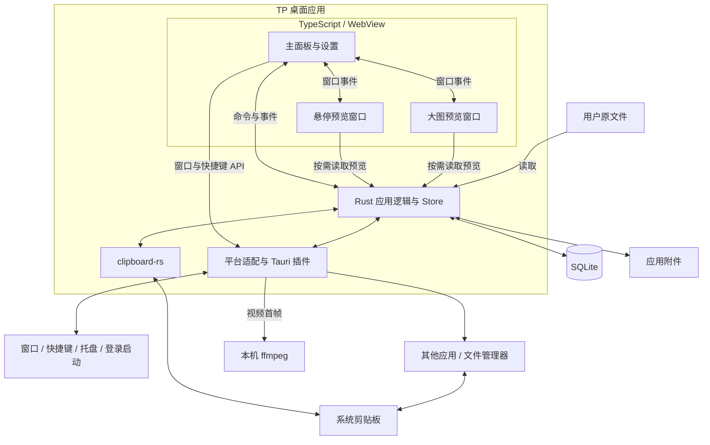
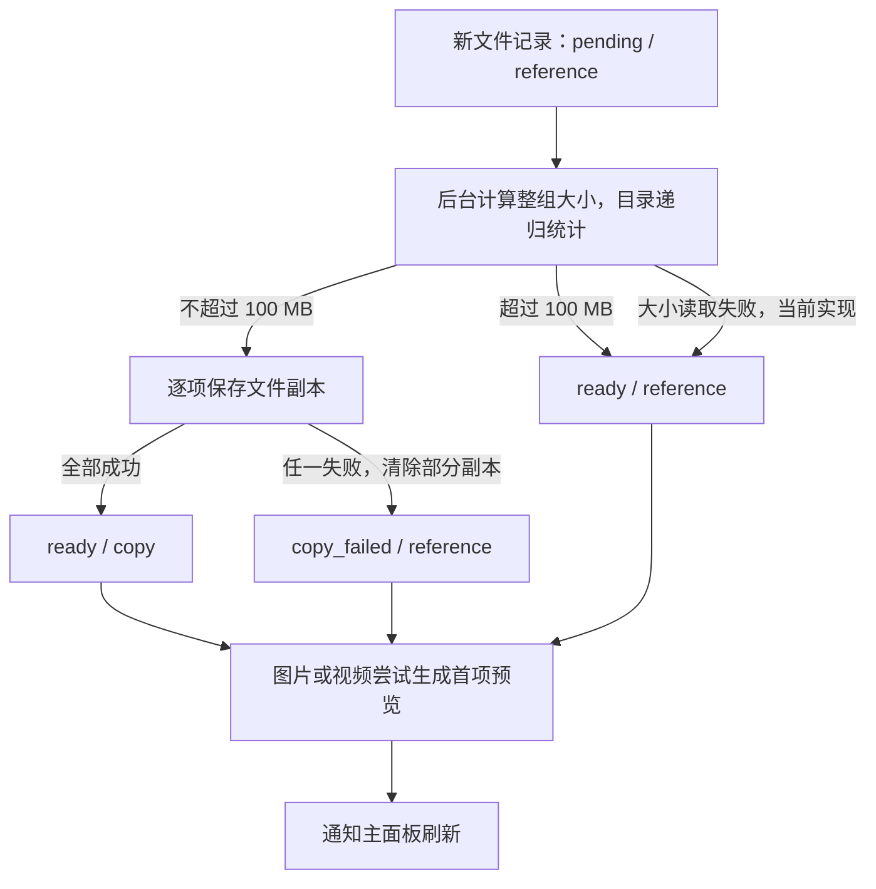

# 系统架构

本文描述 TP 的系统边界、运行组成、数据模型、关键流程与平台适配，以截至 2026-09-29 的仓库代码为依据。产品行为以[产品设计](DESIGN.md)为准，术语以[术语表](GLOSSARY.md)为准；本文将当前实现及其限制与产品要求区分开来，不把代码存在等同于平台验收通过。

## 1. 系统定位与边界

TP 是面向 Windows 11 和 macOS 的本地剪贴板历史工具，以托盘或菜单栏常驻应用运行。它监听系统剪贴板，保存历史记录，让用户通过小面板检索、整理和再次应用记录。

| 边界对象 | 与 TP 的关系 |
| --- | --- |
| 用户 | 通过面板、全局快捷键和托盘或菜单栏入口操作 TP |
| 系统剪贴板 | 提供当前复制内容，并接收 TP 写回的内容；历史记录由 TP 自行保存 |
| 复制来源与粘贴目标应用 | TP 查询活动应用以推测复制来源，记录目标窗口或进程，并尝试切回目标发送粘贴键 |
| 用户原文件 | TP 读取、复制或保留路径引用；删除历史记录不删除用户原文件 |
| 操作系统桌面能力 | 提供窗口、显示器、快捷键、登录启动和资源管理器或 Finder 能力 |
| 本地数据目录 | 保存 SQLite 数据库、图片、视频首帧、缩略图及文件副本 |

系统不包含云端服务、账户或跨设备同步，数据不加密。视频作为文件记录，预览只显示首帧，不播放视频。应用记录的可靠边界是将内容写回系统剪贴板；跨应用粘贴属于后续尝试，目标应用是否接收内容不受 TP 控制。

## 2. 总体组成与职责

TP 采用 Tauri 2 桌面应用结构：TypeScript 页面负责交互，Rust 宿主负责历史记录、持久化和系统操作。三个 WebView 窗口共享同一个 Rust 应用状态，没有独立部署的业务服务。下图是逻辑组成，不表示操作系统进程数量。



以下职责已经存在于代码中，但 Rust 的记录、存储和窗口编排逻辑目前集中在 `app.rs`，尚未拆成独立的服务模块。

| 组成 | 主要职责 | 代码位置 |
| --- | --- | --- |
| 主面板 | 列表、搜索筛选、分组与记录操作、设置、键盘导航、快捷键注册、窗口定位及预览协调 | [src/main.ts](../src/main.ts)、[index.html](../index.html) |
| 预览窗口 | 展示记录内容；按需读取图片、首帧和文本文件；向主面板报告内容尺寸与交互状态 | [src/preview.ts](../src/preview.ts)、[src/large-preview.ts](../src/large-preview.ts) |
| 多页媒体展示 | 纯图片或纯视频组合逐项切换、相邻项预载、页面指示器 | [src/media-carousel.ts](../src/media-carousel.ts)、[src/media-indicators.ts](../src/media-indicators.ts) |
| 记录与附件逻辑 | 剪贴板采集、类型识别、去重、时间与归属维护、清理、文件保存及预览生成 | [src-tauri/src/app.rs](../src-tauri/src/app.rs) |
| 应用宿主 | 初始化 Store、注册命令、后台线程、托盘菜单、窗口生命周期与登录启动 | [src-tauri/src/app.rs](../src-tauri/src/app.rs) 的 `run` |
| 平台适配 | 来源识别、目标捕获、激活目标并发送粘贴键、打开原文件所在目录、边框双击与视频首帧提取 | [src-tauri/src/platform.rs](../src-tauri/src/platform.rs) |
| 应用与权限配置 | 三个窗口、构建入口、应用身份、WebView 能力授权 | [tauri.conf.json](../src-tauri/tauri.conf.json)、[capabilities/default.json](../src-tauri/capabilities/default.json)、[vite.config.ts](../vite.config.ts) |

SQLite 和附件是持久化数据来源，Rust 统一读写它们。前端持有 `Snapshot` 的内存副本和界面状态，不直接访问数据库或文件系统。当前搜索在前端对正文与原路径进行不区分大小写的包含匹配；内容类型筛选只作用于默认视图。

## 3. 运行生命周期与通信

### 3.1 启动、常驻与退出

1. Rust 入口启动 Tauri，在 `store` 插件初始化阶段创建应用数据目录、打开数据库、补充兼容字段，并注册 `Store`；此步骤先于 WebView 窗口创建。
2. 注册全局快捷键和登录启动插件。窗口按配置隐藏创建，Rust 恢复面板置顶设置；此时主面板仍保持隐藏。
3. 启动剪贴板监听、自动清理和粘贴目标捕获线程，创建托盘或菜单栏入口。
4. 主页面建立预览窗口事件通信，调用 `get_state`，恢复面板位置与尺寸，注册已保存的唤出快捷键并监听后续变化，再通过 `show_panel_on_launch` 仅在普通启动时首次显示面板；带 `--autostart` 参数的登录启动保持隐藏。预览页面通过 ready/ping 事件确认就绪。
5. 关闭主面板或按 `Esc` 隐藏窗口，后台任务继续运行；托盘菜单中的“退出”结束应用。悬停预览和大图预览随主面板的主动隐藏关闭。

主窗口 `main`、悬停预览 `preview` 和大图预览 `large-preview` 均无系统装饰；设置是主页面内的覆盖层。三个窗口均关闭 WebView 开发者工具；Windows 通过 WebView2 的 `ContextMenuRequested` 事件从原生右键菜单移除“更多工具”和“检查”及多余分隔线。托盘点击由 Rust 直接显示并聚焦主窗口，再发出 `open-requested` 让前端完成定位。快捷键没有默认值；页面重新加载时会检查并替换当前应用遗留的快捷键绑定。

### 3.2 后台任务与共享状态

| 任务或状态 | 当前实现 |
| --- | --- |
| 剪贴板监听 | 独立线程运行 `ClipboardWatcherContext`，变更回调调用 `ingest` |
| 文件保存 | 每条新文件记录启动一个线程，计算整组大小、复制文件并生成首项预览 |
| 自动清理 | 每秒检查一次；采集新记录、修改清理设置或记录保护状态时也会触发 |
| 粘贴目标 | 每 100 毫秒捕获其他应用的活动窗口或进程；唤出面板时再次尝试捕获 |
| 数据库访问 | `Store.db` 持有一个受 `Mutex` 保护的 SQLite 连接 |
| 媒体生成 | `media_lock` 用于按需预览生成与图片文件初次预览生成的互斥，不覆盖全部附件操作 |
| 临时状态 | `paste_target` 保存粘贴目标；`suppressed_digest` 保存待忽略的主动写回摘要；两者只在内存中存在 |

### 3.3 命令与事件边界

| 方向 | 接口示例 | 作用 |
| --- | --- | --- |
| 页面 → Rust | `get_state` | 返回全部记录、分组与设置；数据库已完成置顶与使用时间排序 |
| 页面 → Rust | `apply_record`、`set_favorite`、`set_record_pinned`、`move_group`、`delete_record`、`batch_records` | 执行单条或批量记录操作，返回结果或错误 |
| 页面 → Rust | `save_settings`、分组命令、缓存命令、`set_autostart` | 保存配置、整理记录或调用系统配置 |
| 页面 → Rust | `preview_data`、`file_text_preview`、`open_record_directory` | 根据记录 ID 和文件序号读取资源或定位原文件 |
| 页面 → Rust | `show_panel_on_launch`、`show_panel`、`hide_panel`、预览窗口命令 | 定位完成后首次显示主面板，控制原生窗口的显示、尺寸和焦点 |
| Rust → 主页面 | `history-changed` | 通知历史数据变化；主页面重新读取完整快照，不接收记录增量 |
| Rust → 主页面 | `open-requested` | 通知托盘唤出；前端执行面板定位等操作 |
| 主页面 ↔ 预览页面 | `preview-*`、`large-preview-*` | 传递预览内容、就绪与尺寸信息、关闭和鼠标交互事件 |

全局快捷键注册及部分窗口操作直接使用 Tauri 前端 API 和插件。普通设置保存由前端串行提交、Rust 校验并写入 SQLite；快捷键先注册成功再保存，失败时尝试恢复原绑定。登录启动状态通过插件查询操作系统，不作为 `Settings` JSON 的字段保存。窗口移动和缩放后的几何信息另有延迟保存逻辑。

## 4. 数据架构

### 4.1 持久化模型

数据库位于 Tauri 返回的应用数据目录，文件名为 `history.sqlite3`，启用 WAL 和外键。应用标识保持 `com.tp.clipboard`，沿用既有安装身份与数据目录。

| 数据对象 | 存储形式与约束 |
| --- | --- |
| 历史记录 `records` | UUID 主键 `id`；唯一摘要 `digest` 防止相同内容重复建档；`kind` 为文本、链接、颜色、图片、视频或文件 |
| 记录内容 | `body` 保存原始文本；`files` 为 JSON 数组，每项保存 `original` 原路径、可空的 `stored` 副本路径及 `isDirectory` 目录标记 |
| 整理状态 | `favorite` 独立于 `group_id`；一条记录最多属于一个自建分组；`pinned_at` 只决定记录排序 |
| 时间 | `created_at` 为创建时间，`used_at` 为最后使用时间，`expires_at` 为可空的敏感记录到期时刻；时间戳使用 Unix 毫秒 |
| 保存与预览状态 | `storage_mode` 区分文件副本 `copy` 与路径引用 `reference`，非文件内容为空字符串；`status` 记录处理状态，`preview` 标记已生成预览 |
| 自建分组 `groups` | 整数主键、唯一名称；删除分组时通过外键将记录的 `group_id` 置空，不直接删除记录 |
| 设置 `settings` | 键 `main` 对应一个 JSON 对象，保存清理规则、快捷键和面板配置 |

“默认”和“收藏”是视图，不是 `groups` 表中的分组。普通记录由 `favorite = 0 AND group_id IS NULL` 判定。`records_used` 索引支持按最后使用时间访问；快照排序顺序为置顶记录优先、置顶时间降序、最后使用时间降序。

`pending` 表示文件保存尚未完成，`ready` 表示已确定文件保存方式且无副本失败标记，或内容不需要文件任务；`copy_failed` 表示副本保存失败。`missing` 是读取快照时根据路径存在性计算的展示状态，不是后台文件监听产生的持久化状态，也不能由 `ready` 推断预览一定可用。

### 4.2 附件组织与所有权

```text
应用数据目录/
├─ history.sqlite3
└─ assets/
   └─ <记录 ID>/
      ├─ image.png                  # 直接复制的图片，或图片文件首项的完整 PNG 画面
      ├─ image-<序号>.png            # 后续图片文件的完整画面，按需生成
      ├─ frame.png                  # 首个视频的完整首帧，最长边不超过 1280 像素
      ├─ frame-<序号>.png            # 后续视频首帧，按需生成
      ├─ thumbnail.png              # 首项列表缩略图
      └─ files/<序号>/<原文件名>      # 文件或目录副本，仅 copy 模式具有
```

这些文件按记录类型和访问需要生成，并非每条记录都有全部附件。文件序号从 0 开始，首项图片和首帧沿用无序号名称。图片文件的完整画面会解码后保存为 PNG；恢复文件粘贴时仍使用 `files` 中的文件副本或原路径，不使用预览 PNG 替代原文件。

TP 可以删除自己持有的附件；原路径只用于读取、再次应用和“打开所在目录”。直接复制的图片没有原始文件路径。文件副本没有总容量上限，普通记录数量上限也不限制收藏或自建分组记录的数量。

### 4.3 兼容现有数据

启动时按数据库字段是否存在补充 `pinned_at` 和 `created_at`。旧记录没有可核实的创建时间，继续保留空值；符合十六进制颜色格式的旧文本记录转换为颜色记录。当前采用启动时兼容处理，没有独立的版本化迁移体系。

旧记录缺少缩略图或多页画面时按需补生成；旧视频源不可用时，首项预览可沿用已有的 `preview.png`。兼容处理不意味着能恢复已经丢失的原文件或副本。

## 5. 关键数据流

### 5.1 复制内容进入历史记录

1. 系统剪贴板变化触发 `ingest`，按“文件组合 → 图片数据 → 文本”的优先级读取；同一次复制只保存其中一种表示，不保留全部剪贴板格式。
2. 文件组合按全部文件的类型归类：纯视频为视频、纯图片为图片，其余为文件；目录归为文件。当前分类依据文件扩展名，图片预览生成时再按实际内容识别格式并解码。不能把预览解码能力理解为已经实现所有文件的内容探测分类。
3. 文本去除首尾空白后若完整匹配十六进制色值则归为颜色，可解析的 HTTP/HTTPS 地址归为链接，其余归为文本；保存和去重仍使用原始文本。
4. 计算 SHA-256 摘要，类型参与所有摘要：文本使用原始字节，直接图片使用 PNG 字节，文件组合按原顺序使用各路径、元数据大小与修改时间。文件顺序参与摘要；目录目前使用目录自身元数据，不递归计算内部文件内容摘要。
5. 若匹配主动写回的待忽略摘要，本次变更不入库。否则根据当前活动应用判断是否来自 1Password，计算独立的 `expires_at`。
6. 已有相同摘要时更新 `used_at` 和本次来源对应的 `expires_at`，保留创建时间、收藏、分组和置顶状态；新内容创建记录并发出 `history-changed`。
7. 直接图片在监听线程保存画面与缩略图；文件记录交给后台线程保存。新记录采集流程随后触发普通记录清理。

来源识别依据活动应用名称或进程路径中是否包含 `1password`，属于启发式判断，没有取得操作系统对剪贴板写入者的可靠身份凭据。应用记录不会重新计算敏感倒计时，再次复制才会按当次来源更新它。

### 5.2 文件保存与可用性



产品中的 100 MB 阈值在代码中按 `100 × 1024 × 1024` 字节判断。只有整组复制成功才切换为 `copy`；保存中或副本失败时仍以原路径为依据，原路径存在才可能应用。预览生成失败不改变文件的保存模式，也不阻止可用文件写回剪贴板。

读取快照时检查非 `pending` 文件记录的实际路径，不可用时显示 `missing`；应用记录前再次检查路径。“打开所在目录”始终验证并使用原路径，按目录分组选中全部原文件；不会打开副本来冒充原文件。

文件复制在独立线程中进行，不等待面板操作，也不介入来源应用的复制动作。当前尚无任务队列、并发上限或重启恢复机制；进程中断后的 `pending` 记录不会自动续传或修复。

### 5.3 应用历史记录

1. 主面板调用 `apply_record`，Rust 从数据库读取记录。文本、链接和颜色写回文本；没有文件项的图片写回图片数据；图片文件、视频和普通文件都写回整个文件组合。
2. 文件副本使用 `stored` 路径，路径引用使用 `original` 路径。代码在副本路径字段为空时会回退原路径；待写回路径不存在则返回错误。
3. 写入前保存待忽略摘要，避免监听器将主动写回当成新的复制。文件副本的路径不同于原路径，因此按实际写回路径重新计算摘要。
4. 剪贴板写入成功后更新原记录的 `used_at` 并通知界面，不改变创建时间和敏感到期时刻。
5. 若有已保存的目标，未开启面板置顶时先隐藏主面板，再尝试激活目标并发送 Windows 的 `Ctrl+V` 或 macOS 的 `Cmd+V`。
6. 发送成功仅返回“已尝试粘贴到原窗口”；无法完成时返回手动粘贴提示，已经写入系统剪贴板的内容仍可使用。

目标记录的是窗口句柄或进程 ID，没有保存输入控件身份，也没有检测输入框是否可编辑。主动写回抑制目前只保存一个待匹配摘要，并非带事件 ID 的可靠去重队列。

### 5.4 浏览与预览

主面板从完整快照筛选出当前视图，列表 DOM 包含筛选后的全部记录；`IntersectionObserver` 只对可见及邻近记录加载缩略图，这不是列表虚拟化。列表刷新时复用已加载的图片节点。
列表没有有效选中记录时选中筛选结果的第一条；面板唤出或切换分组时清除原选中状态并回到顶部，由列表渲染选中当前视图的第一条。空列表不选中记录。
主页面保存当前焦点记录、范围选择起点和已选 ID 集合；Shift+上下方向键或 Shift+点击按筛选后列表顺序选择连续范围。批量删除、收藏、置顶和移动分组由 `batch_records` 一次处理并通知主页面刷新；取消收藏或移出分组后统一执行自动清理。

悬停 300 毫秒后，主面板向预览窗口发送记录内容；在面板中按 `→` 可跳过等待，直接触发同一流程。预览窗口调用 Rust 读取资源并报告尺寸，主面板按当前显示器可用区域定位。大图预览使用另一窗口，单页按画面尺寸适配，多页保持固定窗口尺寸。两种预览共用多页媒体组件，加载相邻页面，并通过请求代次避免过期结果覆盖新内容。

`preview_data` 按记录 ID、角色和序号选择资源，必要时补生成，返回 Base64 PNG data URL。文本文件预览只接受扩展名白名单中的文件，大小不超过 1 MB，编码为 UTF-8 或带 BOM 的 UTF-16；目录、PDF、Office 等不读取内部内容。文本以原文展示，不作为 HTML 或 Markdown 执行。

预览不写回剪贴板，也不更新 `used_at`。纯图片或纯视频文件组合可以逐页预览，混合组合继续按普通文件展示。

### 5.5 清理与删除

自动清理只选取普通记录：先收集超过保留时间或敏感到期时刻的记录，再收集按 `used_at` 排序超出数量限制的记录，合并后删除。默认保留 300 条、7 天，数量最多 500 条；敏感记录默认 90 秒。收藏或自建分组归属能阻止自动删除，记录置顶不能；取消保护或删除分组后立即重新检查清理条件。

删除记录先删除数据库行，再删除该记录的附件目录。正常删除尚在保存中的记录时延后附件删除，由文件任务在发现数据库记录已不存在后清理。手动“清理缓存”还会清理无记录引用的附件，并保护收藏或自建分组记录所引用的应用附件；缓存大小采用同一保护范围计算，不包含原文件和数据库。

数据库操作和附件文件操作不属于同一个事务。敏感记录到期删除的是 TP 历史记录及其附件，不会清空系统剪贴板，也没有实现安全擦除。

## 6. 平台适配与部署依赖

| 能力 | Windows 11 实现 | macOS 实现 |
| --- | --- | --- |
| 剪贴板监听与文本、图片、文件读写 | `clipboard-rs` | `clipboard-rs` |
| 活动应用与来源识别 | `active-win-pos-rs` | `active-win-pos-rs` |
| 粘贴目标与激活 | Win32 捕获前台窗口，排除自身与托盘窗口；激活后再次检查目标 | 保存其他活动应用的进程 ID；通过 `osascript` 与 System Events 激活，再检查活动进程 |
| 发送粘贴键 | `enigo` 发送 `Ctrl+V` | `enigo` 发送 `Cmd+V`；权限与实际效果待 Mac 环境验证 |
| 定位原文件 | Shell API 打开资源管理器并选中各目录中的文件 | `NSWorkspace` 调用 Finder 选中文件 |
| 原生边框双击 | 窗口子类过程处理边框鼠标消息 | AppKit 本地鼠标事件监听 |
| 窗口与托盘 | Tauri 窗口、托盘；WebView2 原生设置关闭主面板浏览器快捷键 | Tauri 窗口与菜单栏入口；平台行为待验证 |
| 全局快捷键与登录启动 | Tauri global-shortcut、autostart 插件 | 相同插件；登录启动使用 LaunchAgent |
| 视频首帧 | 调用 `PATH` 中的 `ffmpeg` | 相同调用方式，待平台验收 |

运行时使用本地 SQLite，`rusqlite` 启用 bundled 特性。视频预览依赖外部 `ffmpeg`，当前没有在打包配置中随应用分发；缺失或执行失败时无法生成新首帧，已有缓存仍可读取，文件记录仍可使用。系统原生 API、剪贴板库和插件的成功调用不能替代目标应用中的实际效果验证。

构建由 Vite 输出主面板与两个预览页面，Tauri 将前端产物与 Rust 宿主打包；发布产物不依赖 Vite 开发服务器。开发与检查命令见 [README](../README.md)，依赖声明见 [package.json](../package.json) 和 [Cargo.toml](../src-tauri/Cargo.toml)。当前机器只有 Windows，macOS 代码虽有条件编译分支，仍需在 Mac 上完成编译、权限与运行验证。

## 7. 架构取舍与当前限制

| 方面 | 已采用的方式 | 当前限制或待补足项 |
| --- | --- | --- |
| 本地保存 | SQLite 保存记录元数据，文件系统保存较大附件；全部留在本机 | 不加密、不同步；副本及受保护记录无总容量上限 |
| 前后端协作 | Rust 集中持久化，事件通知后读取全量快照，前端搜索筛选 | 大量收藏或分组记录会增加快照传输、内存与 DOM 开销，目前没有分页或全文索引 |
| 文件保存响应性 | 每条文件记录使用后台线程，界面通过状态感知进度 | 没有并发上限和中断恢复；大小读取失败时直接保留路径引用，尚无对应的失败说明 |
| 附件一致性 | 数据库锁串行访问，部分媒体生成互斥；文件任务回写保存结果时检查记录是否还存在 | 删除、清缓存、预览生成和复制未统一协调，数据库与附件间也没有崩溃恢复流程 |
| 跨应用交互 | 先写回剪贴板，再尝试激活窗口并发送粘贴键 | 不能验证输入控件及最终粘贴结果；来源识别依赖活动应用，自动粘贴依赖系统权限与目标应用 |
| 内容展示与能力边界 | 正文和路径经转义或 `textContent` 展示；文件读取由 Rust 根据记录定位 | 三个窗口共用 capability；配置中 `csp` 为 `null`，没有配置内容安全策略 |
| 运行反馈 | 命令返回错误供界面提示；监听回调失败写入标准错误 | 监听器创建失败没有面板健康状态提示；未形成持久化诊断日志与统一任务状态 |

这些限制是当前实现边界，不代表已经确定要增加的新功能。后续调整应围绕[产品设计](DESIGN.md)中的行为要求和实际验证结果进行，不据此预设服务拆分或额外基础设施。

## 8. 验证状态与完成条件

现有单元测试位于 [app.rs](../src-tauri/src/app.rs) 的 `tests` 模块，覆盖文本文件预览、原路径分组、文件类型、图片解码与缩略图、颜色迁移、时间字段兼容、置顶排序、批量记录操作、自动清理和缓存清理等逻辑。测试代码存在不表示本次已执行，也不能证明剪贴板、焦点和系统权限行为通过验收。

| 验证范围 | 仓库已有记录与当前边界 |
| --- | --- |
| Windows 剪贴板监听、来源识别、文件写回、自动粘贴、快捷键与定位 | 既有文档列为“原型和实际测试”，未提供逐项结果，不能据此标记为全部通过 |
| Windows 内侧拖拽区双击恢复尺寸 | 既有文档明确记录已运行验证；原生边框双击仍待手动验证 |
| Windows 面板置顶及重启恢复 | 既有文档明确记录已运行验证 |
| Windows 托盘单击、登录后台启动 | 已有实现，仍待运行验证 |
| macOS | 已有适配代码；当前无 Mac 环境，编译、权限和运行行为均待验证 |

系统验收需要逐项确认以下结果，并记录具体平台与测试条件：

1. 文字、图片、单文件和多文件能够采集、去重并正确写回；真实 1Password 桌面复制流程中的来源判断和每条独立倒计时符合产品规则。
2. 文件副本、路径引用、保存失败和原文件缺失的状态与实际可用性一致；自动清理与清理缓存保留收藏及自建分组数据，所有记录删除操作均不删除用户原文件。
3. 快捷键、托盘、登录启动、窗口尺寸与位置、置顶、两种预览和键盘操作在目标平台实际可用。
4. 自动粘贴在输入框、文件管理器等代表性目标中实测；失败时内容仍已回到系统剪贴板，界面不声称粘贴完成。
5. 副本保存中退出、附件删除失败以及缺少 `ffmpeg` 等情况下的行为有明确记录；当前未实现的恢复能力不能记为通过。
