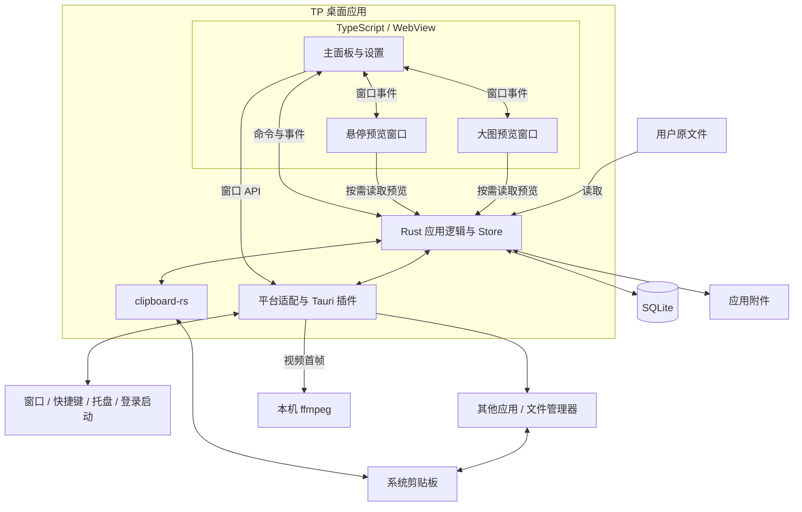
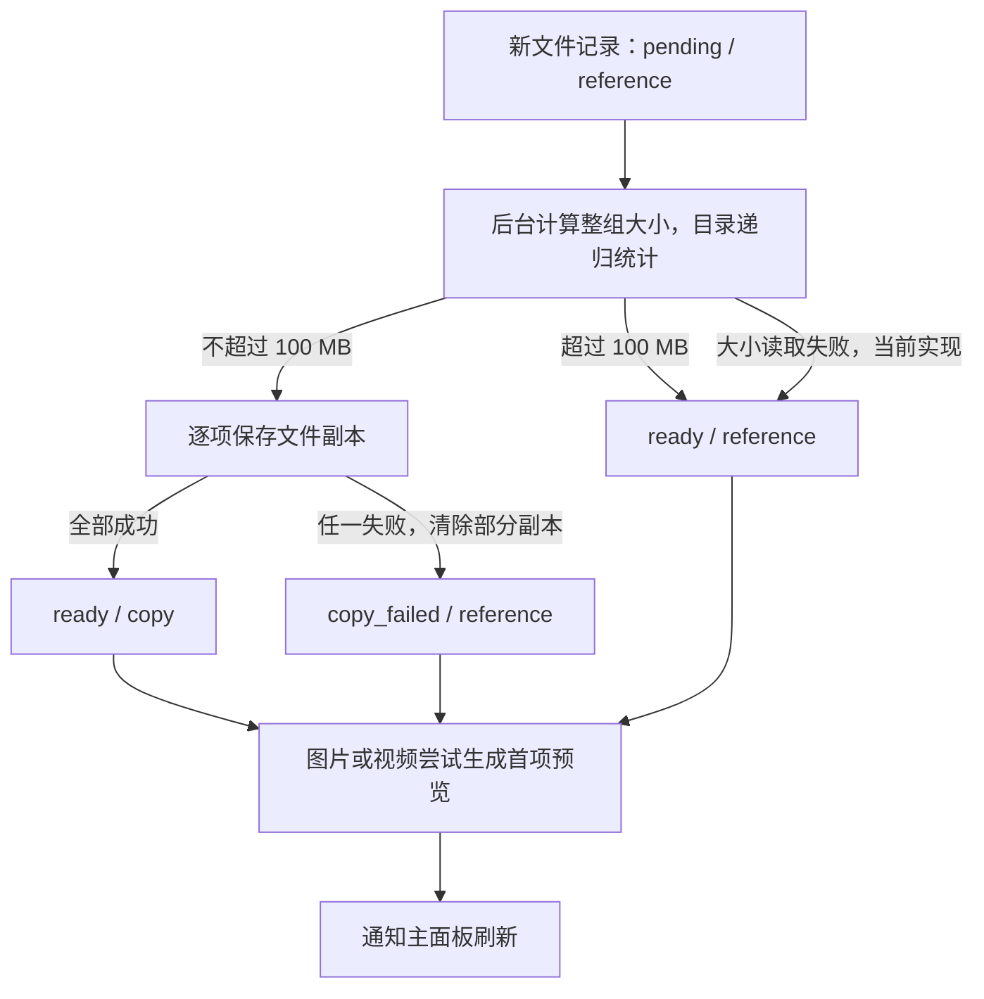

# 系统架构

本文描述 TP 的系统边界、运行组成、数据模型、关键流程与平台适配，以截至 2026-10-03 的仓库代码为依据。产品行为以[产品设计](DESIGN.md)为准，术语以[术语表](GLOSSARY.md)为准；本文将当前实现及其限制与产品要求区分开来，不把代码存在等同于平台验收通过。

## 1. 系统定位与边界

TP 是面向 Windows 11 和 macOS 的本地剪贴板历史工具，以托盘或菜单栏常驻应用运行。它监听系统剪贴板，保存历史记录，让用户通过小面板检索、整理和再次应用记录。

| 边界对象 | 与 TP 的关系 |
| --- | --- |
| 用户 | 通过面板、全局快捷键和托盘或菜单栏入口操作 TP |
| 系统剪贴板 | 提供当前复制内容，并接收 TP 写回的内容；历史记录由 TP 自行保存 |
| 复制来源与粘贴目标应用 | TP 查询活动应用以推测复制来源，记录目标窗口或进程，并尝试切回目标发送粘贴键 |
| 用户原文件 | TP 读取、复制或保留路径引用；删除历史记录不删除用户原文件 |
| 操作系统桌面能力 | 提供窗口、显示器、快捷键、登录启动和资源管理器或 Finder 能力 |
| 本地数据目录 | 保存 SQLite 数据库、图片、视频首帧、缩略图及文件副本 |

系统不包含云端服务、账户或跨设备同步，数据不加密。视频作为文件记录，预览只显示首帧，不播放视频。应用记录的可靠边界是将内容写回系统剪贴板；跨应用粘贴属于后续尝试，目标应用是否接收内容不受 TP 控制。

## 2. 总体组成与职责

TP 采用 Tauri 2 桌面应用结构：TypeScript 页面负责交互，Rust 宿主负责历史记录、持久化和系统操作。三个 WebView 窗口按需创建、共享同一个 Rust 应用状态，后台常驻不依赖页面存活，没有独立部署的业务服务。下图是逻辑组成，不表示操作系统进程数量。



以下职责已经存在于代码中，但 Rust 的记录、存储和窗口编排逻辑目前集中在 `app.rs`，尚未拆成独立的服务模块。

| 组成 | 主要职责 | 代码位置 |
| --- | --- | --- |
| 主面板 | 可见范围内的列表、搜索筛选、分组与记录操作、设置、键盘导航、窗口定位及预览协调；隐藏时释放记录快照与列表 | [src/main.ts](../src/main.ts)、[index.html](../index.html) |
| 预览窗口 | 展示记录内容；按需读取图片、首帧和文本文件；向主面板报告内容尺寸与交互状态；主页面协调按需创建与闲置释放 | [src/preview.ts](../src/preview.ts)、[src/large-preview.ts](../src/large-preview.ts)、[src/preview-windows.ts](../src/preview-windows.ts) |
| 多页媒体展示 | 纯图片或纯视频组合逐项切换、相邻项预载、页面指示器 | [src/media-carousel.ts](../src/media-carousel.ts)、[src/media-indicators.ts](../src/media-indicators.ts) |
| 记录与附件逻辑 | 剪贴板采集、类型识别、去重、时间与归属维护、清理、文件保存及预览生成 | [src-tauri/src/app.rs](../src-tauri/src/app.rs) |
| 应用宿主 | 初始化 Store、注册命令、后台线程、托盘菜单、全局快捷键、按需窗口生命周期、面板浏览状态与登录启动 | [src-tauri/src/app.rs](../src-tauri/src/app.rs) 的 `run` |
| 平台适配 | 来源识别、目标捕获、激活目标并发送粘贴键、打开原文件所在目录、边框双击与视频首帧提取 | [src-tauri/src/platform.rs](../src-tauri/src/platform.rs) |
| 应用与权限配置 | 三个窗口、构建入口、应用身份、WebView 能力授权 | [tauri.conf.json](../src-tauri/tauri.conf.json)、[capabilities/default.json](../src-tauri/capabilities/default.json)、[vite.config.ts](../vite.config.ts) |

SQLite 和附件是持久化数据来源，Rust 统一读写它们。面板可见时前端持有 `Snapshot` 的内存副本和界面状态，隐藏时释放记录快照，不直接访问数据库或文件系统。当前搜索仍在前端对完整快照的正文与原路径进行不区分大小写的包含匹配；列表虚拟化只减少记录行与图片的驻留，不对数据库查询分页。内容类型筛选只作用于默认视图。

## 3. 运行生命周期与通信

### 3.1 启动、常驻与退出

1. Rust 入口启动 Tauri，在 `store` 插件初始化阶段创建应用数据目录、打开数据库、补充兼容字段，并注册 `Store`；此步骤先于 WebView 窗口创建。
2. 注册全局快捷键和登录启动插件，Rust 按已保存的设置绑定唤出快捷键。三个窗口均配置 `create: false`，启动时不创建任何 WebView；后台任务、托盘入口和快捷键不依赖主页面。
3. 启动剪贴板监听、自动清理和粘贴目标捕获线程，创建托盘或菜单栏入口。
4. 唤出快捷键、托盘图标或托盘菜单由 Rust 按需创建主窗口并恢复置顶设置；主页面建立事件通信并报告就绪后，读取最新完整快照、恢复本次运行期间的搜索词、分组和类型筛选、定位并显示面板。使用预览时先监听 ready 事件，再通过异步命令 `ensure_preview_window` 从原配置创建窗口并发送 ping，确认页面就绪后才发送内容；同一窗口的并发请求共用一次创建。
5. 关闭主面板或按 `Esc` 隐藏窗口（搜索词非空时首次按 `Esc` 仅清空搜索词并移走搜索框焦点），后台任务继续运行。Rust 发出 `panel-hidden`，主页面清空列表 DOM、图片及记录快照，不再因 `history-changed` 在后台读取或渲染记录；浏览状态保存在 Rust 内存中。Rust 在主面板隐藏 30 秒后确认其仍隐藏，销毁主窗口和仍隐藏的预览窗口，再次唤出取消计时；重复隐藏不延长计时。
6. 悬停预览和大图预览随主面板的主动隐藏关闭，立即清空内容并开始闲置计时。主页面在各预览隐藏后 30 秒调用 `release_preview_window`，Rust 确认窗口仍隐藏后销毁；再次使用取消计时，若销毁已开始则等待 destroyed 事件后重新创建。重复隐藏不延长计时。主页面被销毁时由 Rust 的窗口释放流程保证剩余隐藏预览一并释放。
7. Windows 页面隐藏时将 WebView2 的 `MemoryUsageTargetLevel` 设为 `Low`，显示前恢复 `Normal`。这是尽力回收，可缩减缓存或将部分内存换到磁盘，不等于释放全部分配，也不保证固定的内存降幅。macOS 使用相同的按需创建与闲置销毁流程，不使用 WebView2 的低内存接口。
8. 最后一个窗口销毁时，Rust 阻止 Tauri 自动退出，让剪贴板监听、清理、托盘和快捷键继续运行；托盘菜单中的“退出”明确结束应用。

主窗口 `main`、悬停预览 `preview` 和大图预览 `large-preview` 均无系统装饰；设置是主页面内的覆盖层。窗口重建时仍从相同配置恢复外观与能力，并重新安装 Windows 原生右键菜单过滤。三个窗口均关闭 WebView 开发者工具；Windows 通过 WebView2 的 `ContextMenuRequested` 事件从原生右键菜单移除“更多工具”和“检查”及多余分隔线。Rust 通过 `open-requested` 让已就绪的主页面完成唤出，加载和定位完成后才显示并聚焦窗口。快捷键没有默认值；页面重建不会重新注册全局快捷键。

### 3.2 后台任务与共享状态

| 任务或状态 | 当前实现 |
| --- | --- |
| 剪贴板监听 | 独立线程运行 `ClipboardWatcherContext`，变更回调调用 `ingest` |
| 文件保存 | 每条新文件记录启动一个线程，计算整组大小、复制文件并生成首项预览 |
| 自动清理 | 每秒检查一次；采集新记录、修改清理设置或记录保护状态时也会触发 |
| 粘贴目标 | 每 100 毫秒捕获其他应用的活动窗口或进程；唤出面板时再次尝试捕获 |
| 数据库访问 | `Store.db` 持有一个受 `Mutex` 保护的 SQLite 连接 |
| 媒体生成 | `media_lock` 用于按需预览生成与图片文件初次预览生成的互斥，不覆盖全部附件操作 |
| 临时状态 | `paste_target` 保存粘贴目标；`suppressed_digest` 保存待忽略的主动写回摘要；面板搜索词、当前分组和类型筛选跨窗口重建保留；这些状态只在本次运行的内存中存在 |

### 3.3 命令与事件边界

| 方向 | 接口示例 | 作用 |
| --- | --- | --- |
| 页面 → Rust | `get_state` | 返回全部记录、分组与设置；数据库已完成置顶与使用时间排序 |
| 页面 → Rust | `apply_record`、`set_favorite`、`set_record_pinned`、`move_group`、`delete_record`、`batch_records` | 执行单条或批量记录操作，返回结果或错误 |
| 页面 → Rust | `save_settings`、分组命令、缓存命令、`set_autostart` | 保存配置、整理记录或调用系统配置 |
| 页面 → Rust | `register_panel_shortcut` | 在 Rust 中替换快捷键绑定，界面销毁后绑定仍有效；注册失败保留原绑定 |
| 页面 → Rust | `panel_ready`、`get_panel_session`、`save_panel_session` | 确认主页面监听已就绪，恢复或保存本次运行的搜索、分组和筛选状态 |
| 页面 → Rust | `preview_data`、`file_text_preview`、`open_record_directory` | 根据记录 ID 和文件序号读取资源或定位原文件 |
| 页面 → Rust | `show_panel`、`hide_panel`、预览窗口命令 | 用户唤出后显示并聚焦主面板，控制原生窗口的显示、尺寸和焦点 |
| 页面 → Rust | `ensure_preview_window`、`release_preview_window` | 首次使用时创建预览窗口，闲置后销毁仍隐藏的窗口 |
| Rust → 主页面 | `history-changed` | 通知历史数据变化；仅可见的主页面重新读取完整快照，不接收记录增量 |
| Rust → 主页面 | `open-requested`、`panel-hidden` | 通知快捷键或托盘唤出，或通知隐藏以释放列表资源；前端执行快照读取与面板定位等操作 |
| Rust → 主页面 | `preview-window-used`、`preview-window-hidden`、`preview-destroyed`、`large-preview-destroyed` | 取消或开始闲置释放计时，并确认窗口销毁完成 |
| 主页面 ↔ 预览页面 | `preview-*`、`large-preview-*` | 传递预览内容、就绪与尺寸信息、关闭和鼠标交互事件 |

全局快捷键在 Rust 注册和处理，部分窗口操作仍使用 Tauri 前端 API。普通设置保存由前端串行提交、Rust 校验并写入 SQLite；快捷键先注册成功再保存，失败时尝试恢复原绑定。登录启动状态通过插件查询操作系统，不作为 `Settings` JSON 的字段保存。窗口移动和缩放后的几何信息另有延迟保存逻辑。

设置页底部的当前版本号通过 Tauri 前端 API `getVersion()` 读取运行中应用的版本信息，不在界面中写死版本号。

## 4. 数据架构

### 4.1 持久化模型

数据库位于 Tauri 返回的应用数据目录，文件名为 `history.sqlite3`，启用 WAL 和外键。应用标识保持 `com.tp.clipboard`，沿用既有安装身份与数据目录。

| 数据对象 | 存储形式与约束 |
| --- | --- |
| 历史记录 `records` | UUID 主键 `id`；唯一摘要 `digest` 防止相同内容重复建档；`kind` 为文本、链接、颜色、图片、视频或文件 |
| 记录内容 | `body` 保存原始文本；`files` 为 JSON 数组，每项保存 `original` 原路径、可空的 `stored` 副本路径及 `isDirectory` 目录标记；直接复制的图片没有原文件，读取快照时另以其 `image.png` 副本路径作为 `assetPath` 返回，供悬停预览显示 |
| 整理状态 | `favorite` 独立于 `group_id`；一条记录最多属于一个自建分组；`pinned_at` 只决定记录排序 |
| 时间 | `created_at` 为创建时间，`used_at` 为最后使用时间，`expires_at` 为可空的敏感记录到期时刻；时间戳使用 Unix 毫秒 |
| 保存与预览状态 | `storage_mode` 区分文件副本 `copy` 与路径引用 `reference`，非文件内容为空字符串；`status` 记录处理状态，`preview` 标记已生成预览 |
| 自建分组 `groups` | 整数主键、唯一名称；删除分组时通过外键将记录的 `group_id` 置空，不直接删除记录 |
| 设置 `settings` | 键 `main` 对应一个 JSON 对象，保存清理规则、快捷键和面板配置 |

“默认”和“收藏”是视图，不是 `groups` 表中的分组。普通记录由 `favorite = 0 AND group_id IS NULL` 判定。`records_used` 索引支持按最后使用时间访问；快照排序顺序为置顶记录优先、置顶时间降序、最后使用时间降序。

`pending` 表示文件保存尚未完成，`ready` 表示已确定文件保存方式且无副本失败标记，或内容不需要文件任务；`copy_failed` 表示副本保存失败。`missing` 是读取快照时根据路径存在性计算的展示状态，不是后台文件监听产生的持久化状态，也不能由 `ready` 推断预览一定可用。

### 4.2 附件组织与所有权

```text
应用数据目录/
├─ history.sqlite3
└─ assets/
   └─ <记录 ID>/
      ├─ image.png                  # 直接复制的图片，或图片文件首项的完整 PNG 画面
      ├─ image-<序号>.png            # 后续图片文件的完整画面，按需生成
      ├─ frame.png                  # 首个视频的完整首帧，最长边不超过 1280 像素
      ├─ frame-<序号>.png            # 后续视频首帧，按需生成
      ├─ hover.png                  # 首张图片的完整悬停预览图，最长边不超过 1440 像素
      ├─ hover-<序号>.png            # 后续图片的悬停预览图，按需生成
      ├─ thumbnail.png              # 首项列表缩略图
      └─ files/<原文件名>             # 文件或目录副本，仅 copy 模式具有
```

这些文件按记录类型和访问需要生成，并非每条记录都有全部附件。图片和视频的完整画面、首帧按文件序号命名，从 0 开始，首项沿用无序号名称。文件副本平铺在同一个 `files` 目录下，一条记录只对应一个副本目录，因此“打开所在目录”只需打开一个窗口即可看到整组文件；组内出现重名文件时，按 `<主名> (n)<扩展名>` 追加序号避免覆盖。恢复文件粘贴时仍使用 `files` 中的文件副本或原路径，不使用预览 PNG 替代原文件。

TP 可以删除自己持有的附件；原路径用于读取、再次应用以及记录右键的“复制路径”“打开所在目录”，但这两项在原文件缺失时改用文件副本。直接复制的图片没有原始文件路径，悬停预览显示的路径与三个右键操作均使用其 `image.png` 副本。“另存为”始终使用文件副本。文件副本没有总容量上限，普通记录数量上限也不限制收藏或自建分组记录的数量。

### 4.3 兼容现有数据

启动时按数据库字段是否存在补充 `pinned_at` 和 `created_at`。旧记录没有可核实的创建时间，继续保留空值；符合十六进制颜色格式的旧文本记录转换为颜色记录。当前采用启动时兼容处理，没有独立的版本化迁移体系。

早期版本按 `files/<序号>/<原文件名>` 保存单个文件副本，同一条记录的各文件落在不同目录下。启动时把这类副本迁移为平铺的 `files/<原文件名>`，并更新记录 `files` 中的副本路径；迁移不重算 `digest`（摘要只由原路径与元数据决定），跳过后台保存未完成的 `pending` 记录，完成后删除遗留的序号目录。迁移按当前磁盘状态执行，可重复运行且结果一致。

旧记录缺少缩略图或多页画面时按需补生成；旧视频源不可用时，首项预览可沿用已有的 `preview.png`。兼容处理不意味着能恢复已经丢失的原文件或副本。

## 5. 关键数据流

### 5.1 复制内容进入历史记录

1. 系统剪贴板变化触发 `ingest`，按“文件组合 → 图片数据 → 文本”的优先级读取；同一次复制只保存其中一种表示，不保留全部剪贴板格式。
2. 文件组合按全部文件的类型归类：纯视频为视频、纯图片为图片，其余为文件；目录归为文件。当前分类依据文件扩展名，图片预览生成时再按实际内容识别格式并解码。不能把预览解码能力理解为已经实现所有文件的内容探测分类。
3. 文本去除首尾空白后若完整匹配十六进制色值则归为颜色，可解析的 HTTP/HTTPS 地址归为链接，其余归为文本；保存和去重仍使用原始文本。
4. 计算 SHA-256 摘要，类型参与所有摘要：文本使用原始字节，直接图片使用 PNG 字节，文件组合按原顺序使用各路径、元数据大小与修改时间。文件顺序参与摘要；目录目前使用目录自身元数据，不递归计算内部文件内容摘要。
5. 若匹配主动写回的待忽略摘要，本次变更不入库。否则根据当前活动应用判断是否来自 1Password，计算独立的 `expires_at`。
6. 已有相同摘要时更新 `used_at` 和本次来源对应的 `expires_at`，保留创建时间、收藏、分组和置顶状态；新内容创建记录并发出 `history-changed`。
7. 直接图片在监听线程保存画面与缩略图；文件记录交给后台线程保存。新记录采集流程随后触发普通记录清理。

来源识别依据活动应用名称或进程路径中是否包含 `1password`，属于启发式判断，没有取得操作系统对剪贴板写入者的可靠身份凭据。应用记录不会重新计算敏感倒计时，再次复制才会按当次来源更新它。

### 5.2 文件保存与可用性



产品中的 100 MB 阈值在代码中按 `100 × 1024 × 1024` 字节判断。只有整组复制成功才切换为 `copy`；保存中或副本失败时仍以原路径为依据，原路径存在才可能应用。预览生成失败不改变文件的保存模式，也不阻止可用文件写回剪贴板。

读取快照时检查非 `pending` 文件记录的实际路径，不可用时显示 `missing`；应用记录前再次检查路径。没有目录项的文件、图片和视频记录在主面板右键时，整项由页面菜单处理而非 WebView2 原生菜单：“复制路径”和“打开所在目录”按每项优先原路径、再用现有副本；“另存为”只使用副本。直接复制的图片以 `image.png` 作为副本。目录记录不显示此菜单。“打开所在目录”按实际路径的父目录分组：文件副本记录的各文件同属一个 `files` 目录，只打开一个窗口；路径引用记录的原文件可能分散在不同目录，按目录分别打开。

文件复制在独立线程中进行，不等待面板操作，也不介入来源应用的复制动作。当前尚无任务队列、并发上限或重启恢复机制；进程中断后的 `pending` 记录不会自动续传或修复。

### 5.3 应用历史记录

1. 主面板调用 `apply_record`，Rust 从数据库读取记录。文本、链接和颜色写回文本；没有文件项的图片同时写回图片数据、本工具保存的图片文件和纯文本路径，让终端和只读文本的编辑器（如 Zed）可按路径粘贴、聊天框仍按图片粘贴；图片文件、视频和普通文件都写回整个文件组合。
2. 文件副本使用 `stored` 路径，路径引用使用 `original` 路径。代码在副本路径字段为空时会回退原路径；待写回路径不存在则返回错误。
3. 写入前保存待忽略摘要，避免监听器将主动写回当成新的复制。文件副本的路径不同于原路径，因此按实际写回路径重新计算摘要；截图图片写回后剪贴板包含文件路径，监听器会按文件计算摘要，因此也按写回的文件路径重新计算。该抑制只服务于 `apply_record`：记录右键的“复制路径”属于用户主动复制，只写入纯文本路径且不保存待忽略摘要，因此与普通复制一样按文本记录进入历史。
4. 剪贴板写入成功后更新原记录的 `used_at` 并通知界面，不改变创建时间和敏感到期时刻。
5. 若有已保存的目标，未开启面板置顶时先隐藏主面板，再尝试激活目标并发送 Windows 的 `Ctrl+V` 或 macOS 的 `Cmd+V`。
6. 发送成功仅返回“已尝试粘贴到原窗口”；无法完成时返回手动粘贴提示，已经写入系统剪贴板的内容仍可使用。

目标记录的是窗口句柄或进程 ID，没有保存输入控件身份，也没有检测输入框是否可编辑。主动写回抑制目前只保存一个待匹配摘要，并非带事件 ID 的可靠去重队列。

### 5.4 浏览与预览

主面板可见时从完整快照筛选出当前视图，按普通行 48 像素、图片和视频行 180 像素计算完整列表高度。列表 DOM 只保留可见范围与上下各约 180 像素内的记录，其他位置由占位高度保持滚动范围；记录离开该范围后其 DOM 和缩略图释放。列表刷新时复用仍在创建范围内的已加载图片节点。键盘导航、范围选择和可见序号按完整筛选结果计算，选择当前未创建的记录时先滚动并创建其记录行。
无搜索词时，文本和链接记录的列表文字由正文首个换行符之前的部分构成（兼容 `\r\n` 与 `\r`）；该行之后还有非空白行时，渲染前在文字末尾追加 ` ...`（空格加省略号），由前端字符串而非 CSS 负责这一提示，单行省略号只用于宽度截断。搜索词的命中片段展示不追加该标记。
列表没有有效选中记录时选中筛选结果的第一条；面板唤出或切换分组时清除原选中状态并回到顶部，由列表渲染选中当前视图的第一条。空列表不选中记录。
普通上下方向键在筛选后的当前列表中循环单选：第一条按上方向键跳到最后一条，最后一条按下方向键回到第一条，并将目标记录滚入可见范围；单条记录保持选中。
主页面通过 `Ctrl+F` 聚焦搜索框，只在搜索框聚焦时接受搜索输入；普通字符、输入法和 Backspace 不再从其他对象转入搜索框。输入控件未聚焦时，单独按 `1` 至 `9`（含数字小键盘）在 `keydown` 中立即应用对应可见序号的记录，忽略长按重复事件；不再等待 Ctrl 松开。两种平台共用这些前端规则。
`Ctrl+D` 调用 `batch_records` 切换所有选中记录的收藏状态。记录删除只在输入控件未聚焦时处理：两平台都匹配 `ctrlKey` 与 `key === "Backspace"`，界面分别显示 Windows 的 `Ctrl+Backspace` 和 macOS 的 `Ctrl+Delete`；Windows 额外接受不带修饰键的 `key === "Delete"`，macOS 不接受向前删除键。其依据是 [MDN 的按键定义](https://developer.mozilla.org/en-US/docs/Web/API/UI_Events/Keyboard_event_key_values)：Mac 主键盘标为 Delete 的键发送 `Backspace`，向前删除发送 `Delete`；[Apple 快捷键说明](https://support.apple.com/en-us/102650)列出 `Fn+Delete` 的向前删除行为。删除忽略长按重复事件、输入法组合及其他修饰键。
主页面保存当前焦点记录、范围选择起点和已选 ID 集合；Shift+上下方向键或 Shift+点击按筛选后列表顺序选择连续范围，Shift+方向键到首尾停止。批量删除、收藏、置顶和移动分组由 `batch_records` 一次处理并通知主页面刷新；取消收藏或移出分组后统一执行自动清理。

悬停 300 毫秒后，主面板向预览窗口发送记录内容；在面板中按 `→` 可跳过等待，直接触发同一流程。预览窗口调用 Rust 读取资源并报告尺寸，主面板按当前显示器可用区域定位。大图预览使用另一窗口，单页按画面尺寸适配，多页保持固定窗口尺寸。两种预览共用多页媒体组件，加载相邻页面，并通过请求代次避免过期结果覆盖新内容。

悬停预览的路径来自记录的 `files`；直接复制的图片没有文件项，主面板改用快照返回的 `assetPath`（`assets/<记录 ID>/image.png`）作为唯一路径发送，因此该路径与“复制路径”及应用记录写回时使用的一致。该路径不参与列表搜索，只有文件项的 `original` 参与。

`preview_data` 按记录 ID、角色和序号选择资源，必要时补生成，返回 Base64 PNG data URL。图片的 `thumbnail` 角色读取列表缩略图，`preview` 角色按需生成并复用最长边不超过 1440 像素的完整悬停预览图，`full` 角色仍读取完整尺寸 PNG；缩小图不裁剪、不放大，也不替代原图。旧记录在首次悬停时补生成小图；`preview_data` 在线程池中执行，避免首次图片解码与缩小阻塞窗口事件处理。视频首帧已有 1280 像素限制，读取方式不变。文本文件预览只接受扩展名白名单中的文件，大小不超过 1 MB，编码为 UTF-8 或带 BOM 的 UTF-16；目录、PDF、Office 等不读取内部内容。文本以原文展示，不作为 HTML 或 Markdown 执行。

预览不写回剪贴板，也不更新 `used_at`。纯图片或纯视频文件组合可以逐页预览，混合组合继续按普通文件展示。

### 5.5 清理与删除

自动清理只选取普通记录：以同一个检查时刻收集超过保留时间或敏感到期时刻的记录，再从尚未到期的普通记录中收集按 `used_at` 排序超出数量限制的记录，合并后删除；到期记录不占用保留名额。默认保留 300 条、7 天，数量最多 500 条；敏感记录默认 90 秒。保留时间从最后使用时间起算，恰好达到保留天数时仍保留，超过后删除。收藏或自建分组归属能阻止自动删除，记录置顶不能；取消保护或删除分组后立即重新检查清理条件。

`save_settings` 修改普通记录数量上限或保留时间时复用 `cleanup_ids` 计算待删除条数；需要删除且尚未获得足够数量的确认时，返回 `confirmation_required` 与条数，不保存设置或删除记录。前端用面板内的 HTML `dialog` 显示确认弹窗，沿用设置页字体、浅色边框、圆角与按钮样式，删除按钮沿用“清理缓存”的红色；等待期间不持有数据库锁且继续使用原设置。取消或按 Esc 关闭弹窗后前端恢复已保存的设置，隐藏面板也会取消待确认操作；确认后携带 `confirmedCount` 再次调用后端，待删除条数增加则再次询问，否则在同一次数据库加锁期间保存设置并删除记录，返回 `saved`。前端保存队列避免确认弹窗导致数字输入失焦时重复提交相同变更。不删除已有记录的设置变更直接生效。

删除记录先删除数据库行，再删除该记录的附件目录。正常删除尚在保存中的记录时延后附件删除，由文件任务在发现数据库记录已不存在后清理。手动“清理缓存”还会清理无记录引用的附件，并保护收藏或自建分组记录所引用的应用附件；缓存大小采用同一保护范围计算，不包含原文件和数据库。

数据库操作和附件文件操作不属于同一个事务。敏感记录到期删除的是 TP 历史记录及其附件，不会清空系统剪贴板，也没有实现安全擦除。

## 6. 平台适配与部署依赖

| 能力 | Windows 11 实现 | macOS 实现 |
| --- | --- | --- |
| 剪贴板监听与文本、图片、文件读写 | `clipboard-rs`；截图图片写回时用 `clipboard-win` 在一次会话内写入 PNG、`CF_DIB`、`CF_HDROP` 和 `CF_UNICODETEXT` | `clipboard-rs` 的 `set` 同时写入文本、图片和文件，待 Mac 验证 |
| 活动应用与来源识别 | `active-win-pos-rs` | `active-win-pos-rs` |
| 粘贴目标与激活 | Win32 捕获前台窗口，排除自身与托盘窗口；激活后再次检查目标 | 保存其他活动应用的进程 ID；通过 `osascript` 与 System Events 激活，再检查活动进程 |
| 发送粘贴键 | `enigo` 发送 `Ctrl+V` | `enigo` 发送 `Cmd+V`；权限与实际效果待 Mac 环境验证 |
| 定位文件与另存为 | Shell API 打开资源管理器并选中各目录中的文件；`rfd` 选择另存为目录 | `NSWorkspace` 调用 Finder 选中文件；`rfd` 选择另存为目录（待 Mac 验证） |
| 原生边框双击 | 窗口子类过程处理边框鼠标消息 | AppKit 本地鼠标事件监听 |
| 窗口与托盘 | Tauri 窗口、托盘；无边框窗口沿用系统边框，窗口阴影、1 像素边框和约 8 像素圆角由 DWM 绘制；WebView2 原生设置关闭主面板浏览器快捷键 | Tauri 窗口与菜单栏入口；平台行为待验证 |
| 全局快捷键与登录启动 | Rust 使用 Tauri global-shortcut 插件注册和唤出面板，不依赖 WebView；autostart 插件 | 相同插件与公共窗口生命周期；登录启动使用 LaunchAgent，待 Mac 验证 |
| 视频首帧 | 调用 `PATH` 中的 `ffmpeg` | 相同调用方式，待平台验收 |

运行时使用本地 SQLite，`rusqlite` 启用 bundled 特性。视频预览依赖外部 `ffmpeg`，当前没有在打包配置中随应用分发；缺失或执行失败时无法生成新首帧，已有缓存仍可读取，文件记录仍可使用。系统原生 API、剪贴板库和插件的成功调用不能替代目标应用中的实际效果验证。

构建由 Vite 输出主面板与两个预览页面，Tauri 将前端产物与 Rust 宿主打包；发布产物不依赖 Vite 开发服务器。开发与检查命令见 [README](../README.md)，依赖声明见 [package.json](../package.json) 和 [Cargo.toml](../src-tauri/Cargo.toml)。当前机器只有 Windows，macOS 代码虽有条件编译分支，仍需在 Mac 上完成编译、权限与运行验证。

## 7. 架构取舍与当前限制

| 方面 | 已采用的方式 | 当前限制或待补足项 |
| --- | --- | --- |
| 本地保存 | SQLite 保存记录元数据，文件系统保存较大附件；全部留在本机 | 不加密、不同步；副本及受保护记录无总容量上限 |
| 前后端协作 | Rust 集中持久化，面板可见时事件通知后读取全量快照，前端搜索筛选；列表只创建可见及邻近记录 | 大量收藏或分组记录仍会增加面板打开时的快照传输与数据内存，目前没有分页或全文索引 |
| 后台内存 | 启动不创建 WebView；隐藏清空列表并停止刷新，Windows 页面进入低内存模式，闲置后销毁窗口 | 重新唤出需要重建页面并读取快照；WebView2 的尽力回收与进程退出不保证固定的内存降幅或耗时 |
| 文件保存响应性 | 每条文件记录使用后台线程，界面通过状态感知进度 | 没有并发上限和中断恢复；大小读取失败时直接保留路径引用，尚无对应的失败说明 |
| 附件一致性 | 数据库锁串行访问，部分媒体生成互斥；文件任务回写保存结果时检查记录是否还存在 | 删除、清缓存、预览生成和复制未统一协调，数据库与附件间也没有崩溃恢复流程 |
| 跨应用交互 | 先写回剪贴板，再尝试激活窗口并发送粘贴键 | 不能验证输入控件及最终粘贴结果；来源识别依赖活动应用，自动粘贴依赖系统权限与目标应用 |
| 内容展示与能力边界 | 正文和路径经转义或 `textContent` 展示；文件读取由 Rust 根据记录定位 | 三个窗口共用 capability；配置中 `csp` 为 `null`，没有配置内容安全策略 |
| 运行反馈 | 命令返回错误供界面提示；监听回调失败写入标准错误 | 监听器创建失败没有面板健康状态提示；未形成持久化诊断日志与统一任务状态 |
| 窗口外观 | 面板与两个预览窗沿用系统窗口边框，页面容器在系统半径内取同值圆角 | 圆角半径由系统决定、无法配置；页面比窗口可见区小 1 像素，贴边内容的圆角最多比系统圆角内缩约 1 像素；macOS 无系统圆角时的窗口边缘表现待 Mac 环境验证 |

这些限制是当前实现边界，不代表已经确定要增加的新功能。后续调整应围绕[产品设计](DESIGN.md)中的行为要求和实际验证结果进行，不据此预设服务拆分或额外基础设施。

## 8. 验证状态与完成条件

现有单元测试位于 [app.rs](../src-tauri/src/app.rs) 的 `tests` 模块，覆盖文本文件预览、原路径分组、文件类型、图片解码与缩略图、悬停预览图的尺寸与缓存复用、颜色迁移、时间字段兼容、置顶排序、批量记录操作、自动清理和缓存清理等逻辑。测试代码存在不表示本次已执行，也不能证明剪贴板、焦点和系统权限行为通过验收。
2026-10-03 此次保留规则检查的 29 项 Rust 测试通过：补充验证 1、3、5、7、30 天的时间边界、按最后使用时间计时、1、300、500 条数量上限、收藏与分组豁免、置顶不豁免，以及敏感到期记录不占用数量名额。Windows 运行实例的只读数据库快照核查显示：当时设置为 300 条、3 天，共 171 条记录，其中普通记录 164 条、受保护记录 7 条；最旧普通记录距最后使用约 2.81 天，没有超出数量、保留时间或敏感到期时刻的普通记录。通过当前进程已打开文件的只读映射取得数据，并校验 WAL 提交帧与 SQLite 完整性；直接重开同名路径读到不同文件，未用其结果判断运行实例。此次未修改真实记录或设置，也未在 macOS 上运行验证。
同日用户将数量上限改为 100 条后，运行实例的只读快照显示普通记录已降至 100 条、受保护记录仍为 7 条，共 107 条。随后增加设置清理确认：31 项 Rust 测试、107 项前端测试及前端构建通过，覆盖删除条数合并与保护豁免、确认前不修改数据、新增记录后重新确认、无删除直接保存，以及前端等待、确认、取消恢复、保存失败、重复失焦提交、隐藏面板时取消和页内弹窗的确认、取消、关闭。Windows 桌面实际验证将保留时间从 3 天临时改为 24 小时：面板内弹窗提示将删除 41 条记录，显示“取消”和“删除并应用”；点击取消后弹窗关闭，控件恢复 3 天。只读复核设置仍为 100 条、3 天，普通记录 100 条、受保护记录 7 条均未变。未在真实记录上点击“删除并应用”，macOS 尚未运行验证。
前端记录导航测试位于 [record-navigation.test.mjs](../tests/record-navigation.test.mjs)，通过 `npm test` 运行，覆盖首尾循环、当前视图筛选、空列表、单条记录、Shift 连续选择以及选中记录滚出屏幕后打开分组菜单。列表范围与滚动计算测试位于 [list-layout.test.mjs](../tests/list-layout.test.mjs)；主面板测试位于 [panel-lifecycle.test.mjs](../tests/panel-lifecycle.test.mjs)，验证隐藏不刷新、释放图片与记录、拒绝过期请求、就绪握手和并发唤出。焦点与滚动的单元测试使用模拟对象。预览窗口生命周期测试位于 [preview-windows.test.mjs](../tests/preview-windows.test.mjs)，模拟事件与计时器验证首次创建与就绪等待、并发创建、闲置释放、重复隐藏、重用取消释放及销毁期间重开。
主面板键盘测试位于 [panel-keyboard.test.mjs](../tests/panel-keyboard.test.mjs)，模拟键盘事件验证 `Ctrl+F` 聚焦搜索、未聚焦时不自动转入搜索、搜索框内保留原生输入，以及数字序号即时应用、修饰键与输入法保护、长按不重复应用；同时模拟 Windows 与 macOS 验证 `Ctrl+D` 批量收藏切换、退格与向前删除键的记录删除规则及搜索焦点保护。2026-10-03 此次快捷键修改的 94 项前端测试及前端构建通过；尚未在桌面窗口中实际验证这些新快捷键的焦点、删除与粘贴效果，也未在 macOS 上运行验证。

| 验证范围 | 仓库已有记录与当前边界 |
| --- | --- |
| Windows 剪贴板监听、来源识别、文件写回、自动粘贴、快捷键与定位 | 既有文档列为“原型和实际测试”，未提供逐项结果，不能据此标记为全部通过 |
| Windows 内侧拖拽区双击恢复尺寸 | 既有文档明确记录已运行验证；原生边框双击仍待手动验证 |
| Windows 面板置顶及重启恢复 | 既有文档明确记录已运行验证 |
| Windows 托盘单击、登录后台启动 | 已有实现，仍待运行验证 |
| Windows 预览窗口按需创建、闲置销毁与悬停小图（前一阶段） | 2026-10-03 使用独立数据目录、调试宿主与打包前端运行验证：当时启动仅一个主页面；3840×2160 合成图的悬停图为 1440×810，大图仍为 3840×2160；隐藏后清空图片，约 30 秒后仅剩主页面，两种预览均能重新创建并加载。该实例的 WebView2 私有工作集合计在预览创建后约 177.6 MiB，闲置释放后约 106.0 MiB；这组结果只对应预览优化阶段，不代表本次主面板释放后的内存或其他记录量下的占用。当时 23 项前端测试、26 项 Rust 测试及前端构建已通过 |
| Windows 主面板按需创建、闲置销毁、隐藏资源释放与列表虚拟化 | 2026-10-03 使用独立数据目录、调试宿主与打包前端验证：2,001 条合成记录下仅渲染约 9～14 条附近记录，首尾键盘导航、搜索、分组筛选及滚出屏幕后 Ctrl+G 菜单通过；隐藏后列表和图片清空，历史变化不触发快照读取。启动时无 WebView2 进程，宿主私有工作集约 2.4～2.9 MiB；使用后隐藏约 30 秒，全部 WebView2 进程退出，宿主约 5.6 MiB。无界面时复制测试文字可采集，随后恢复原剪贴板文字；冷启动连续快捷键、短暂隐藏重用、销毁后快捷键重建、搜索与分组筛选恢复、托盘唤出及快捷键更换通过。隐藏时 Low 模式实测降低 WebView2 私有工作集，恢复时采用 Normal；这些数据不保证其他记录量、运行时版本或正式构建的固定内存。36 项前端测试、26 项 Rust 测试及前端构建通过 |
| Windows 静默启动 | 已用 `cargo build` 的调试构建配合 Vite 开发服务器运行验证：启动后主面板保持隐藏，唤出快捷键可显示并聚焦面板；托盘单击与登录启动仍未运行验证 |
| macOS | 已有适配代码；当前无 Mac 环境，编译、权限和运行行为均待验证 |

系统验收需要逐项确认以下结果，并记录具体平台与测试条件：

1. 文字、图片、单文件和多文件能够采集、去重并正确写回；真实 1Password 桌面复制流程中的来源判断和每条独立倒计时符合产品规则。
2. 文件副本、路径引用、保存失败和原文件缺失的状态与实际可用性一致；自动清理与清理缓存保留收藏及自建分组数据，所有记录删除操作均不删除用户原文件。
3. 快捷键、托盘、登录启动、窗口尺寸与位置、置顶、两种预览和键盘操作在目标平台实际可用。
4. 自动粘贴在输入框、文件管理器等代表性目标中实测；失败时内容仍已回到系统剪贴板，界面不声称粘贴完成。
5. 副本保存中退出、附件删除失败以及缺少 `ffmpeg` 等情况下的行为有明确记录；当前未实现的恢复能力不能记为通过。
