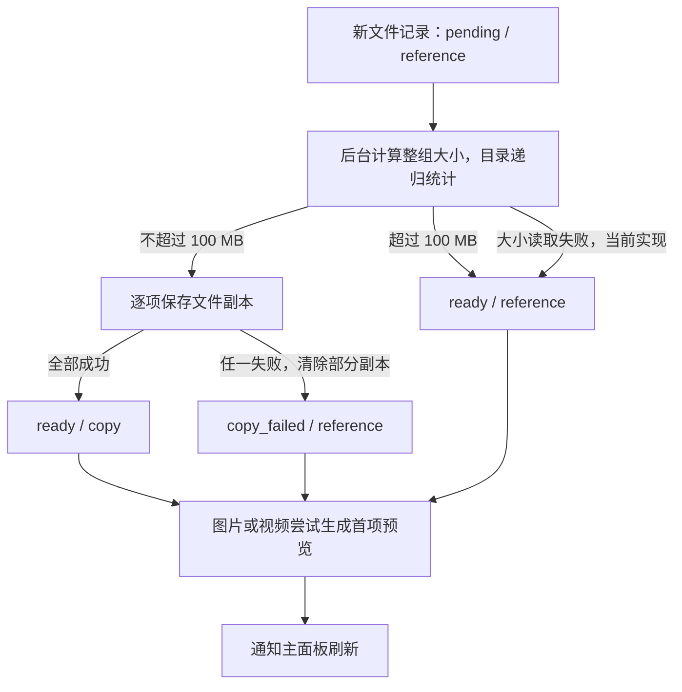

# 系统架构

本文描述 TP 的系统边界、运行组成、数据模型、关键流程与平台适配，以截至 2026-10-15 的仓库代码为依据。产品行为以[产品设计](DESIGN.md)为准，术语以[术语表](GLOSSARY.md)为准；本文将当前实现及其限制与产品要求区分开来，不把代码存在等同于平台验收通过。

原创代码采用根目录 MIT 许可证，第三方依赖仍按各自许可分发。Tauri 的 `bundle.resources` 将项目 `LICENSE` 和 `public/third-party-notices.txt` 作为独立资源随安装包分发，前端构建也保留该声明。更新依赖时同步核对第三方声明。GitHub Actions 当前检查前端、模拟浏览器回归及 Windows 构建；macOS 构建检查暂未启用，仍待适配和验证。使用与构建入口见 README。

## 1. 系统定位与边界

平台代码使用 Windows 和 macOS 条件编译，字体读取和面板挂起只提供这两个平台的实现。自动检查中的前端和浏览器回归使用 Windows 环境，桌面构建目前也只使用 Windows 环境；macOS 适配时再恢复对应的构建检查。

TP 是面向 Windows 11 和 macOS 的本地剪贴板历史工具，以托盘或菜单栏常驻应用运行。它监听系统剪贴板，保存历史记录，让用户通过小面板检索、整理和再次应用记录。

| 边界对象 | 与 TP 的关系 |
| --- | --- |
| 用户 | 通过面板、全局快捷键和托盘或菜单栏入口操作 TP |
| 系统剪贴板 | 提供当前复制内容，并接收 TP 写回的内容；历史记录由 TP 自行保存 |
| 复制来源与粘贴目标应用 | TP 查询活动应用以推测复制来源，记录目标窗口或进程，并尝试切回目标发送粘贴键 |
| 用户原文件 | TP 读取、复制或保留路径引用；删除历史记录不删除用户原文件 |
| 操作系统桌面能力 | 提供窗口、显示器、快捷键、登录启动和资源管理器或 Finder 能力 |
| 本地数据目录 | 保存 SQLite 数据库、图片、视频首帧、缩略图及文件副本 |

系统不包含云端服务、账户或跨设备同步，数据不加密。视频作为文件记录，预览只显示首帧，不播放视频。应用记录的可靠边界是将内容写回系统剪贴板；跨应用粘贴属于后续尝试，目标应用是否接收内容不受 TP 控制。

## 2. 总体组成与职责

TP 采用 Tauri 2 桌面应用结构：React 与 TypeScript 页面负责交互，Rust 宿主负责历史记录、持久化和系统操作。三个 WebView 窗口按需创建、共享同一个 Rust 应用状态，后台常驻不依赖页面存活，没有独立部署的业务服务。下图是逻辑组成，不表示操作系统进程数量。


三个前端入口只挂载 React 根组件，`app.rs` 只组装 Rust 宿主与命令。模块按业务职责拆分，保留原有命令名、事件载荷、SQLite 格式、应用身份和样式。

| 组成 | 主要职责 | 代码位置 |
| --- | --- | --- |
| 界面组装 | 挂载 React、组合主面板、组装控制器和事件监听 | [src/main.ts](../src/main.ts)、[src/App.tsx](../src/App.tsx)、[src/application.ts](../src/application.ts) |
| 主面板组件 | 搜索与类型筛选、分组页签、虚拟列表和记录行、设置、弹出菜单与确认弹窗 | [src/components](../src/components) |
| 界面图标 | `lucide-react` 具名导入经公共 `Icon` 组件映射，统一尺寸、线宽与颜色继承；主面板与两个预览页面复用，收藏保留实心状态，分页指示器使用圆形与短线；许可声明随前端资源打包 | [components/Icon.tsx](../src/components/Icon.tsx)、[media-indicators.css](../src/media-indicators.css)、[third-party-notices.txt](../public/third-party-notices.txt) |
| 应用标志 | 标题栏使用小尺寸单色 SVG，Windows 使用专用彩色托盘 PNG，macOS 使用透明单色 PNG 与模板模式；`bundle.icon` 引用 ICO/ICNS/PNG。macOS 未运行验证 | [icons](../src-tauri/icons)、[runtime.rs](../src-tauri/src/app/runtime.rs)、[tp-mark.svg](../public/tp-mark.svg) |
| 面板状态 | 完整快照读取与请求合并、拒绝过期响应、浏览会话、选中范围、隐藏后释放快照 | [src/state/panel.ts](../src/state/panel.ts) |
| 记录标题编辑 | 原地编辑、标题校验、保存与失败恢复、取消及异步生命周期保护 | [src/state/record-rename.ts](../src/state/record-rename.ts) |
| 设置与分组状态 | 串行设置提交、清理确认和恢复、快捷键注册回退、缓存与登录启动；分组编辑、名称校验和排序保存及失败恢复 | [src/state/settings.ts](../src/state/settings.ts)、[src/state/groups.ts](../src/state/groups.ts)、[src/state/menus.ts](../src/state/menus.ts) |
| 主题配色 | 已审核色板、七色色条、CIEDE2000 排序、悬浮即时切换与预览窗口同步 | [domain/themes.ts](../src/domain/themes.ts)、[domain/color-distance.ts](../src/domain/color-distance.ts)、[components/ThemeSetting.tsx](../src/components/ThemeSetting.tsx)、[services/theme.ts](../src/services/theme.ts)、[theme.css](../src/theme.css) |
| 界面字体 | 完整字体家族及真实样式枚举、双下拉选择、全局应用、持久化与预览窗口同步 | [app/fonts.rs](../src-tauri/src/app/fonts.rs)、[domain/fonts.ts](../src/domain/fonts.ts)、[components/FontSetting.tsx](../src/components/FontSetting.tsx)、[components/FontStyleSetting.tsx](../src/components/FontStyleSetting.tsx)、[services/fonts.ts](../src/services/fonts.ts) |
| 前端系统服务 | Tauri 命令、窗口定位调用和平台缩放、预览协调和就绪握手、焦点还原；独立事件监听并行注册及失败清理 | [src/services](../src/services)、[src/preview-windows.ts](../src/preview-windows.ts) |
| 前端领域与键盘 | 数据契约、过滤、显示文本和连续选择的纯计算；键盘操作规则 | [src/domain](../src/domain)、[src/input](../src/input)、[src/list-layout.ts](../src/list-layout.ts) |
| 预览页面 | React 渲染文本、路径、颜色、图片和视频首帧；测量尺寸、读取单文件文本与清空内容 | [src/preview](../src/preview)、[src/preview.ts](../src/preview.ts)、[src/large-preview.ts](../src/large-preview.ts) |
| 多页媒体展示 | 逐项切换、相邻项预载、页码指示器；React 组件通过 effect 管理既有动画引擎的创建与销毁，动画只操作独立子树 | [src/components/MediaCarousel.tsx](../src/components/MediaCarousel.tsx)、[src/media-carousel.ts](../src/media-carousel.ts)、[src/media-indicators.ts](../src/media-indicators.ts) |
| Rust 模型与存储 | 序列化契约和设置校验、共享窗口会话；Store、SQLite 初始化与旧数据迁移、设置读取和快照查询 | [app/model.rs](../src-tauri/src/app/model.rs)、[app/session.rs](../src-tauri/src/app/session.rs)、[app/storage.rs](../src-tauri/src/app/storage.rs) |
| 记录与清理 | 单条和批量整理、分组操作；普通记录和敏感记录到期、保护规则、清理缓存与删除数量确认 | [app/records.rs](../src-tauri/src/app/records.rs)、[app/cleanup.rs](../src-tauri/src/app/cleanup.rs)、[app/settings.rs](../src-tauri/src/app/settings.rs) |
| 文件与媒体 | 文件副本任务、路径复制、打开目录与另存为；缩略图、悬停图、原图、视频首帧与文本文件预览 | [app/files.rs](../src-tauri/src/app/files.rs)、[app/filesystem.rs](../src-tauri/src/app/filesystem.rs)、[app/media.rs](../src-tauri/src/app/media.rs) |
| 剪贴板 | 采集、识别、去重、主动写回抑制、应用记录和粘贴目标 | [app/clipboard.rs](../src-tauri/src/app/clipboard.rs)、[clipboard_text.rs](../src-tauri/src/clipboard_text.rs)、[app/digest.rs](../src-tauri/src/app/digest.rs)、[app/targets.rs](../src-tauri/src/app/targets.rs) |
| 宿主与窗口 | Tauri 插件、命令注册、事件循环；后台线程与托盘；主面板和预览生命周期、全局快捷键、WebView2 适配 | [app.rs](../src-tauri/src/app.rs)、[app/runtime.rs](../src-tauri/src/app/runtime.rs)、[app/panel.rs](../src-tauri/src/app/panel.rs)、[app/panel_geometry.rs](../src-tauri/src/app/panel_geometry.rs)、[app/panel_runtime.rs](../src-tauri/src/app/panel_runtime.rs)、[app/preview.rs](../src-tauri/src/app/preview.rs)、[app/webview.rs](../src-tauri/src/app/webview.rs) |
| 平台适配 | 来源识别、目标捕获、激活目标并发送粘贴键、打开原文件所在目录、边框双击与视频首帧提取 | [platform.rs](../src-tauri/src/platform.rs) |
| 应用与权限配置 | 三个窗口、构建入口、应用身份、WebView 能力授权 | [tauri.conf.json](../src-tauri/tauri.conf.json)、[capabilities/default.json](../src-tauri/capabilities/default.json)、[vite.config.ts](../vite.config.ts) |

依赖方向与状态边界：

- 前端由 `application.ts` 组装服务与控制器；组件通过 props 和 `useSyncExternalStore` 订阅缓存的不可变快照。领域计算不依赖 React、DOM 或 Tauri；状态控制器通过注入的命令接口调用宿主，不导入组件。系统服务只通过 `viewport.ts` 的测量、滚动和焦点接口访问列表，不创建或替换记录 DOM。
- React 拥有主界面和预览卡片的 DOM。列表依据已有高度算法创建可见行，记录 ID 作为 key，异步缩略图和预览请求在组件卸载后不再提交。轮播的动画子树交给既有引擎，React effect 在清空或卸载时销毁引擎，防止双重管理。
- Rust 宿主向下组装窗口、后台任务和命令模块；剪贴板与记录操作调用存储、清理和附件能力。存储依赖模型、摘要和文件基础函数，不依赖窗口或 React；媒体生成不依赖剪贴板采集或文件副本任务。文件副本任务可以调用媒体生成，避免媒体与文件模块互相依赖。模块和共享接口只在 `app` 内部可见，平台特有代码继续留在 `platform.rs` 和 `webview.rs`。
- 复杂度集中在有明确生命周期的模块中：面板控制器处理刷新/隐藏竞态，设置控制器处理串行写入与确认，预览服务处理异步就绪/尺寸/关闭。入口不承载这些状态机；数据库锁、清理保护和媒体锁的原有范围保持一致。

SQLite 和附件是持久化数据来源，Rust 统一读写它们。面板可见时前端持有 `Snapshot` 的内存副本和界面状态，隐藏后保留一分钟，到期释放记录快照，不直接访问数据库或文件系统。当前搜索仍在前端对完整快照的记录标题、正文与原路径进行不区分大小写的包含匹配；列表虚拟化只减少记录行与图片的驻留，不对数据库查询分页。内容类型筛选只作用于默认视图。

## 3. 运行生命周期与通信

### 3.1 启动、常驻与退出

1. Rust 入口启动 Tauri，在 `store` 插件初始化阶段创建应用数据目录、打开数据库、补充兼容字段，并注册 `Store`；此步骤先于 WebView 窗口创建。
2. 注册全局快捷键和登录启动插件，Rust 按已保存的设置绑定唤出快捷键，并恢复数据库中的登录启动选择；已开启时重新写入当前可执行文件路径，以支持保留数据的卸载重装。旧数据没有登录启动选择时，保存当前系统状态。恢复失败记录错误、保留已保存的选择以供下次重试，设置页仍读取系统实际状态。三个窗口均配置 `create: false`，启动时不创建任何 WebView；后台任务、托盘入口和快捷键不依赖主页面。
3. 启动剪贴板监听、自动清理和粘贴目标捕获线程，创建托盘或菜单栏入口。
4. 唤出快捷键、托盘图标或托盘菜单由 Rust 按需创建主窗口并恢复置顶设置；主页面并行注册主面板和预览事件监听、读取浏览会话，确认全部监听完成并恢复会话后报告就绪；注册失败时清理已完成的监听，页面已卸载时清理迟到的监听且不报告就绪。页面就绪后，`PanelController.open` 先将分组重置为 `default`，再读取最新完整快照、恢复本次运行期间分别按“保留搜索框输入”和“保留类型筛选”设置处理的搜索词和类型筛选、定位并显示面板。默认短暂隐藏后重用窗口与闲置挂起后恢复均执行同一打开流程；开启后台常驻且已有快照时，先按保留内容定位、显示并聚焦，再读取最新快照；Rust 在通知主页面前先恢复原生页面运行及可见控制器，避免恢复后窗口显示但页面未绘制。使用预览时先监听 ready 事件，再通过异步命令 `ensure_preview_window` 从原配置创建窗口并发送 ping，确认页面就绪后才发送内容；同一窗口的并发请求共用一次创建。
5. 关闭主面板或按 `Esc` 隐藏窗口（搜索词非空时首次按 `Esc` 仅清空搜索词并移走搜索框焦点），后台任务继续运行。Rust 发出 `panel-hidden`，主页面停止读取和刷新记录，保留快照、列表 DOM 和已加载图片；组件依据快照是否存在渲染，隐藏状态禁止列表快捷键操作。浏览状态保存在 Rust 内存中。“保留搜索框输入”关闭时，Rust 的统一隐藏流程清空会话搜索词，前端隐藏时也清空输入框并保存空搜索词；隐藏期间收到延迟的会话保存也会按已保存设置清空搜索词。设置保存完成前已经隐藏面板时，前后端在保存成功后补做清空，避免下次唤出恢复旧词。“保留类型筛选”默认开启且旧配置缺省时按开启读取；关闭时，前后端在统一隐藏流程将会话类型筛选恢复为 `all`，隐藏期间的延迟会话保存及设置保存完成后的补处理也执行此规则。两个保留开关互相独立，关闭时均不立即改变仍显示的面板；分组不受它们影响。Windows 与 macOS 共用此设置和会话处理逻辑。未开启“后台常驻”且持续隐藏满 1 分钟后，Rust 确认窗口仍隐藏，进入 `Clearing` 阶段并发送 `panel-idle-release`；前端用 `flushSync` 清空快照与列表、卸载图片，再调用 `panel_content_released` 确认。Rust 核对同一隐藏序号和窗口状态后，销毁仍隐藏的预览窗口并尝试挂起主页面，保留主窗口及已初始化的运行环境。隐藏时间在挂起后继续保留，以保护关闭搜索保留时迟到的会话保存；再次唤出取消计时。打开、隐藏和闲置清空事件携带递增序号，前端忽略过期通知，Rust 忽略过期清空确认与挂起回调；唤出期间完成的旧原生挂起必要时补做恢复。重复隐藏不延长计时或重复发送隐藏事件。挂起被拒绝或不受支持时保留已清空的隐藏面板，本轮不重复尝试。
6. 悬停预览和大图预览随主面板的主动隐藏关闭，立即清空内容并开始闲置计时。主页面在各预览隐藏后 30 秒调用 `release_preview_window`，Rust 确认窗口仍隐藏后销毁；再次使用取消计时，若销毁已开始则等待 destroyed 事件后重新创建。重复隐藏不延长计时。主页面挂起前由 Rust 再次销毁剩余隐藏预览，避免页面计时器受后台节流影响而遗漏。
7. 未开启“后台常驻”时，Windows 主面板隐藏满一分钟后将 WebView2 控制器设为不可见并调用 `TrySuspend`，唤出前调用 `Resume` 并恢复控制器可见性；主面板不再混用手动 `MemoryUsageTargetLevel` 切换。预览页面仍在隐藏时设置 `Low`、显示前恢复 `Normal`。这些操作尽力回收，可缩减缓存或将内存换到磁盘，不等于释放全部分配，也不保证固定降幅。macOS 14 及以上通过公开的 `WKPreferences.inactiveSchedulingPolicy` 将策略设为 `Suspend` 并暂时从原父视图移出 WKWebView，恢复时还原策略并重新接回父视图；旧系统检测不到此 API 时保留清空后的隐藏面板，不调用私有接口。macOS 实现尚未运行验证。
8. 最后一个窗口销毁时，Rust 阻止 Tauri 自动退出，让剪贴板监听、清理、托盘和快捷键继续运行；托盘菜单中的“退出”明确结束应用。

主窗口 `main`、悬停预览 `preview` 和大图预览 `large-preview` 均无系统装饰；设置是主页面内的覆盖层。窗口重建时仍从相同配置恢复外观与能力，并重新安装 Windows 原生右键菜单过滤。三个窗口均关闭 WebView 开发者工具；Windows 通过 WebView2 的 `ContextMenuRequested` 事件从原生右键菜单移除“更多工具”和“检查”及多余分隔线。Rust 通过 `open-requested` 让已就绪的主页面完成唤出，默认在加载和定位完成后显示并聚焦窗口；常驻且已有快照时先显示再刷新。前端通过一次 `place_panel` 命令提交当前设置，Rust 在同一调用中恢复物理尺寸、查询目标屏幕并定位，避免逐项往返调用窗口 API；固定位置与跟随光标、记忆位置的规则保持一致。设置页切换位置模式只保存配置，不调用 `place_panel`；当前窗口保持原位，下一次唤出读取最新配置后再定位。首次唤出仍按需创建窗口；默认日常关闭后保留内容一分钟，到期清空并尝试挂起；开启“后台常驻”后持续保留内容，不执行闲置清空与挂起，不再因闲置销毁主窗口。后台历史变更只通知处于活动状态的主页面，隐藏期间不执行历史刷新脚本；恢复后统一读取最新完整快照。全局唤出快捷键没有默认值；页面重建不会重新注册全局快捷键。

2026-10-13 后台常驻验证：Windows 上 157 项前端模块测试、60 项 Rust 测试、44 项 Edge 界面回归、前端构建和 Windows 调试构建通过；最后调整异步刷新后再次通过常驻专项界面测试。覆盖默认关闭、旧配置兼容、开关保存与失败恢复、闲置和过期挂起请求拦截、关闭开关后重新计时、图片节点保留，以及慢速刷新下连续唤出。界面测试使用模拟 IPC，尚未对本次常驻模式进行真实 WebView2 长时间隐藏及全局快捷键端到端验证；macOS 未编译或运行验证。

“后台常驻”使用设置字段 `backgroundResident`（默认 `false`），主面板创建时从数据库恢复到 `PanelState`。设置保存成功后立即同步生命周期；启用时跳过闲置检查、拒绝清空确认，并恢复可能已挂起的页面。切换时作废旧生命周期序号，隐藏面板同步新序号；关闭时从当前时刻重新计时，过期原生挂起回调必要时补做恢复。前端也拒绝清空常驻面板。隐藏期间仍不推送历史事件；首次创建或页面重载没有快照时，仍先加载再显示。该规则共用于 Windows 与 macOS，预览窗口的闲置销毁不变。

主页面开始导航时重置就绪状态并作废旧清空请求；新页面报告 `panel_ready` 时，若有待处理的唤出请求或原生窗口已经可见，自动发送新一轮 `open-requested`，恢复快照、列表及焦点。隐藏窗口的普通页面重载只同步当前隐藏序号，仍保持隐藏并沿用原闲置截止时间。

开发服务器模式（`tauri::is_dev()`）进入挂起流程时设置 `PanelState.reload_before_open`。快捷键取消闲置任务时保留该标志；`open_panel` 在恢复前通过 `begin_reload_for_open` 作废旧文档序号、标记未就绪并保留唤出请求，恢复 WebView 后在原生窗口仍隐藏时调用 `reload`，不向旧页面发送 `open-requested`。新页面完成初始化并调用 `panel_ready` 后，才读取记录、定位并显示。这样避免 WebView 挂起断开 Vite WebSocket 后，先显示旧页面再被 Vite 自动重载的闪烁。窗口与原生运行环境仍复用，开发页面初始化会增加少量等待；未释放的面板与正式应用不执行这次主动重载。Windows 和 macOS 共用状态与入口。

2026-10-20 恢复闪烁验证：独立 Windows WebView2 宿主、真实挂起及临时 Ctrl+Alt+F10 快捷键下，修复前两次恢复都在窗口已显示时启动新页面；修复后两次均在窗口隐藏时启动新页面，随后各显示一次，显示后观察 5 秒未再导航且记录恢复。68 项 Rust 测试、186 项前端模块测试、前端构建及 4 项界面专项回归通过。此项验证未录制物理显示逐帧画面，macOS 未编译或运行。

2026-10-20 正式构建恢复验证：使用内嵌生产页面、`release` 优化及 `custom-protocol`，运行时确认 `tauri::is_dev() == false`、调试断言关闭。独立 Windows WebView2 宿主中，80 条合成文字和 1 张图片分别以靛蓝、石墨主题实测：通过正常关闭按钮隐藏约 60 秒自动释放，确认原生挂起，再分别额外挂起约 2 秒、30 秒，通过真实 Ctrl+Alt+F10 唤出。两轮共采集 105 张实际屏幕画面，未捕捉到整板空白、白屏或闪烁；从首次出现起列表与图片完整，深色控件仅有短暂局部颜色过渡。每次恢复只显示一次，显示后观察 5 秒未导航，整个运行仅初始化一次文档。此次检查无需追加产品代码修改。采样最大间隔约 55 毫秒，不能排除完全落在采样间隙的瞬时变化；这是独立验证宿主的运行测试，不包含安装包安装过程，macOS 未运行。

开发模式设置页顶部通过 `import.meta.env.DEV` 显示“开发测试”。“立即释放面板”先刷新待保存主题并等待设置写入队列，再调用 `debug_release_panel`；后端仅在 Rust `debug_assertions` 构建中执行，正式构建返回错误。命令拒绝后台常驻或尚未就绪的面板，复用 `hide_panel` 后将闲置截止时间提前，再调用原有 `suspend_idle_panel`，完整沿用清空确认、隐藏序号校验、预览销毁和平台挂起流程。Windows 与 macOS 使用同一入口，不修改记录或设置。

2026-10-20 开发测试入口验证：Windows 前端构建、183 项既有模块测试、3 项新增设置队列与失败恢复测试、67 项 Rust 测试和 1 项 Edge 专项界面测试通过。确认正式前端产物不包含开发测试区块及按钮；界面测试使用模拟 IPC，覆盖立即卸载、常驻禁用和唤出恢复，尚未验证真实 WebView2 宿主中的按钮挂起过程；macOS 未编译或运行验证。

### 3.2 后台任务与共享状态

| 任务或状态 | 当前实现 |
| --- | --- |
| 剪贴板监听 | 独立线程运行 `ClipboardWatcherContext`，变更回调调用 `ingest` |
| 文件保存 | 每条新文件记录启动一个线程，计算整组大小、复制文件并生成首项预览 |
| 自动清理 | 每秒检查一次；采集新记录、修改清理设置或记录保护状态时也会触发 |
| 粘贴目标 | 每 100 毫秒捕获其他应用的活动窗口或进程；唤出面板时再次尝试捕获 |
| 数据库访问 | `Store.db` 持有一个受 `Mutex` 保护的 SQLite 连接 |
| 媒体生成 | `media_lock` 用于按需预览生成与图片文件初次预览生成的互斥，不覆盖全部附件操作 |
| 临时状态 | `paste_target` 保存粘贴目标；`suppressed_digest` 保存待忽略的主动写回摘要；当前分组和类型筛选跨窗口重建保留，搜索词按“保留搜索框输入”设置在隐藏时保留或清空；这些状态只在本次运行的内存中存在 |

### 3.3 命令与事件边界

| 方向 | 接口示例 | 作用 |
| --- | --- | --- |
| 页面 → Rust | `get_state` | 返回全部记录、分组与设置；数据库已完成置顶与使用时间排序 |
| 页面 → Rust | `rename_record`、`apply_record`、`set_favorite`、`set_record_pinned`、`move_group`、`delete_record`、`batch_records` | 执行单条或批量记录操作，返回结果或错误 |
| 页面 → Rust | `save_settings`、`save_panel_geometry`、分组命令、缓存命令、`set_autostart` | 保存配置、整理记录或调用系统配置 |
| 页面 → Rust | `get_theme`、`get_font` | 预览页面就绪前读取已保存的主题与字体，不加载完整历史记录 |
| 页面 → Rust | `get_system_fonts` | Windows 通过 DirectWrite、macOS 通过 AppKit 读取完整家族、名称别名及真实样式（名称、渲染名称、字重、宽度和倾斜），按元数据归类，过滤模拟样式及私有字体 |
| 页面 → Rust | `register_panel_shortcut` | 在 Rust 中替换快捷键绑定，界面销毁后绑定仍有效；注册失败保留原绑定 |
| 页面 → Rust | `panel_ready`、`get_panel_session`、`save_panel_session` | 确认主页面监听已就绪，恢复或保存本次运行的浏览状态；每次唤出由前端将分组重置为默认，搜索和类型筛选沿用各自规则 |
| 页面 → Rust | `panel_content_released` | 确认指定隐藏序号的内容已卸载；Rust 再核对窗口与序号，随后挂起 |
| 页面 → Rust | `preview_data`、`file_text_preview`、`open_record_directory` | 根据记录 ID 和文件序号读取资源或定位原文件 |
| 页面 → Rust | `place_panel`、`show_panel`、`hide_panel`、预览窗口命令 | 用户唤出后显示并聚焦主面板，控制原生窗口的显示、尺寸和焦点 |
| 页面 → Rust | `ensure_preview_window`、`release_preview_window` | 首次使用时创建预览窗口，闲置后销毁仍隐藏的窗口 |
| Rust → 主页面 | `history-changed` | 仅向处于活动状态的主页面通知历史变化，页面读取完整快照；隐藏与挂起期间不发送，不接收记录增量 |
| Rust → 主页面 | `open-requested`、`panel-hidden`、`panel-idle-release` | 携带原生生命周期序号，分别通知唤出、隐藏保留内容、满一分钟清空内容；前端拒绝过期通知 |
| Rust → 主页面 | `preview-window-used`、`preview-window-hidden`、`preview-destroyed`、`large-preview-destroyed` | 取消或开始闲置释放计时，并确认窗口销毁完成 |
| 主页面 ↔ 预览页面 | `preview-*`、`large-preview-*` | 传递预览内容、就绪与尺寸信息、关闭和鼠标交互事件 |
| 主页面 → 预览页面 | `theme-changed` | 悬浮切换时广播主题 ID，两个预览立即同步；预览内容载荷也携带主题 ID |
| 主页面 → 预览页面 | `font-changed` | 选择及保存完成时广播 `{ family, style }`，两个预览立即同步家族和样式；空家族恢复默认字体及样式 |

全局快捷键在 Rust 注册和处理，主面板唤出定位通过 Rust 命令批量执行，拖拽与部分预览窗口操作仍使用 Tauri 前端 API。普通设置保存由前端串行提交、Rust 校验并写入 SQLite；全局唤出快捷键先注册成功再保存，失败时尝试恢复原绑定。记录重命名快捷键属于前端局部按键，不调用全局注册命令。登录启动状态通过插件查询操作系统，不作为 `Settings` JSON 的字段保存。窗口移动和缩放后的几何信息另有延迟保存逻辑。

记录重命名快捷键对应 `Settings.renameShortcut` / Rust `rename_shortcut`，默认及旧 JSON 缺失值均为 `F2`。设置控制器录入按键并串行保存；失败保留草稿与原生效值，输入项下显示错误。Windows 和 macOS 共用按键表示（Control、Alt、Shift、Super）与匹配逻辑，功能键支持 F1 至 F24，字母及数字须带修饰键；前后端拒绝与固定列表操作或唤出快捷键重复的配置，空字符串表示关闭快捷键。`domain/shortcuts.ts` 共用录入及匹配规则；键盘处理仅在焦点位于 `#list`、不在文字输入、设置或菜单中且有当前记录时调用 `startRecordRename`，保护输入法与长按重复。记录右键菜单和设置快捷键表读取已保存的按键显示。

“保留搜索框输入”对应 `Settings.retainSearchInput`，通过设置页复选框变更后立即保存；Rust 字段 `retain_search_input` 对旧 JSON 的缺失值使用 `true`，不重置其他已有设置。Windows 与 macOS 共用设置和隐藏处理。

“在任务栏显示图标”对应 `Settings.showTaskbarIcon`，默认及旧 JSON 缺失值均为 `true`。Windows 主面板创建时读取 SQLite 设置，用 `skip_taskbar(!show_taskbar_icon)` 覆盖固定窗口配置；保存变更时对已存在的主窗口调用 `set_skip_taskbar`，写入失败时尝试恢复原值。主窗口尚未创建时只保存设置，下一次创建时应用。预览窗口保留 `skipTaskbar: true`。此设置仅在 Windows 界面提供，macOS 共用设置序列化但不调用不受支持的任务栏接口，菜单栏及 Dock 行为沿用原实现。桌面任务栏实际显示、最小化及窗口重建行为仍需在 Windows 运行验证；macOS 未运行验证。

设置页“存储”分组的当前版本号通过 Tauri 前端 API `getVersion()` 读取运行中应用的版本信息，不在界面中写死版本号。

设置页沿用主页面覆盖层和原有控制器，只在 `SettingsPanel`、`ThemeSetting` 与样式中采用 B 方案的行式分组卡片。小窗口单列展示，宽度达到 760 像素时以侧栏按钮滚动到同页分组；主题触发按钮增加当前七色色条。原有输入、复选框、单选、下拉菜单及事件处理保留，开关外观由 CSS 绘制，强制颜色模式恢复原生复选框。业务状态、后端命令、保存队列、数字提交与清理确认流程不变。

2026-10-15 设置页样式调整验证：前端构建、159 项前端单元测试和 47 项 Windows Edge 界面回归通过。Codex 内置浏览器检查了 420×600 默认面板、340×400 最小窗口、1000×800 侧栏布局及浅色、深色主题。界面验证使用实际 React 组件与模拟 IPC，未在 Windows 桌面宿主或 macOS 实机运行验证此次样式调整。

主题设置对应 `Settings.theme` / Rust `theme`，使用稳定 ID 存入现有 SQLite 设置 JSON，缺失或未知值回退到默认 `indigo`。Windows 和 macOS 共用十一套色板、CSS 变量、列表控件与持久化代码，无平台专用主题分支。`ThemeSetting` 左侧显示简称，触发按钮和选项右侧的七色色条通过 `themeSwatches` 按 CIELAB 明度 L* 从深到浅排列；实际主题色值不变。主题列表浅色在深色前，默认靛蓝固定开头，后续采用最近邻。相似度仍按颜色角色逐项对应计算七色色块的 CIEDE2000 加权平均，不使用排序后的展示顺序；强调色权重为 3、其余各为 1。算法实现按 [Sharma/Wu/Dalal 的说明与 34 组参考数据](https://hajim.rochester.edu/ece/sites/gsharma/ciede2000/)验证，不宣称最近邻得到全局最优路径。

“记忆拖拽位置”开关开启时通过 `SettingsController` 读取当前物理坐标并保存；开启和关闭都不传递重新定位标志，不调用 `place_panel`。关闭后在下次唤出时按固定位置定位，当前窗口不移动。Windows 与 macOS 共用此逻辑。

2026-10-15 设置细节修正验证：前端构建、168 项前端单元测试和 53 项 Windows Edge 界面回归通过。新增覆盖七色色条明度顺序、默认靛蓝优先、手动清理确认/取消/Esc/默认 Enter/隐藏面板、保护记录保留、失败重试、确认队列互斥，以及记忆位置开关双向切换不定位、下次唤出使用最新设置。Codex 内置浏览器检查了实际主题列表与清理弹窗；测试使用模拟 IPC 和演示记录，未执行真实缓存删除或在 macOS 实机运行验证。

设置控制器通过 `themeDraft` 立即更新外观，停留 160 毫秒后复用串行设置队列保存，关闭设置或隐藏时提交待保存的最后选择；保存完成仅在选择序号仍一致时清除草稿，失败恢复最后已保存主题。`PanelController` 用设置修订序号保护保存期间的旧快照响应，避免快照将新主题覆盖。主面板在布局阶段设置 CSS 变量并广播主题，预览入口先注册主题监听，再读取 `get_theme`，读取期间收到新主题时忽略旧的启动响应，然后挂载预览组件并报告就绪。未改变原始图片或视频首帧的像素，大图关闭按钮保留对明暗图片均可辨认的深色背景和浅色描边。

2026-10-11 记录重命名：131 项前端单元测试、43 项 Rust 测试、32 项浏览器界面回归和前端构建通过。Rust 测试覆盖旧数据库补充标题、六种类型持久化及重启恢复、原内容和整理状态不变、空标题与错误处理；界面测试使用本机 Edge、演示记录和模拟 IPC，覆盖菜单顺序、路径操作、六类显示和行高、标题搜索、输入法与快捷键保护、失败草稿恢复。Codex 内置浏览器另通过实际组件测试页检查右键重命名和最终显示。未验证用户真实数据库、桌面跨应用粘贴或 macOS 实机运行。

同日简化重命名编辑状态后，前端构建和四项重命名界面回归通过，逐项覆盖六种类型仅显示整行输入框、常规字重、“输入标题”提示、无额外焦点环及保存后的展示恢复。Codex 内置浏览器另检查图片和视频编辑行，确认其他元素隐藏、仅保留输入框，outline 为 0 px、box-shadow 为 none。验证使用演示记录和模拟 IPC，未进行 macOS 实机验证。

随后按用户修正，图片和视频编辑改为保留原画面并在上方显示输入框。前端构建和四项重命名界面回归通过，检查媒体编辑行高 212 px、输入框在画面上方、播放标记保留、无额外焦点环、缩略图进入及结束编辑不重复读取；普通记录仍仅显示输入框。此项验证在 Windows 使用本机 Edge、演示记录及模拟 IPC，未进行 macOS 实机验证。

同日移除记录和分组右键菜单项的外围焦点环，保留现有焦点与键盘处理，键盘焦点提示改用浅色行背景。前端构建及 25 项主面板与重命名界面检查通过（分组用例修正后单独重跑），包含 Enter 保存后再次右键无焦点环、方向键选择与 Enter 重命名、分组菜单聚焦无外框及悬停高亮。验证使用 Windows Edge 和模拟 IPC，未进行 macOS 实机验证。

随后取消右键菜单打开时对第一项的自动聚焦，改为聚焦无外框的菜单容器；记录和分组菜单每次打开均无预选项，方向键首次选择首项或末项，未选择时 Enter/Space 不执行操作。131 项前端单元测试、25 项 Windows Edge 界面回归和前端构建通过，界面回归覆盖重命名保存后重新打开无高亮、分组菜单重新打开清除选择、方向键循环与 Esc 返回触发对象。仍使用演示记录及模拟 IPC，未进行 macOS 实机验证。

同日添加可配置的记录重命名快捷键：135 项前端单元测试、45 项 Rust 测试、26 项 Windows Edge 主面板及重命名界面回归和前端构建通过。覆盖默认 F2、自定义与清除、菜单当前按键、列表作用范围、输入与设置保护、失败草稿恢复、旧配置兼容与数据库重启读取。单元测试模拟 Windows 与 macOS 按键；界面回归使用 Windows 演示记录和模拟 IPC，未进行 macOS 实机验证。

随后调整普通记录的标题宽度：取消 45% 上限，标题按实际宽度优先占用内容区域，正文仅使用剩余空间；标题超过可用宽度时才省略，正文收缩至零。标题和正文仍保持 8 px 间距，内容裁切避免越过右侧操作按钮。前端构建及五项重命名界面回归通过，逐项检查文字、链接、文件、颜色的完整标题、剩余正文、超长标题与悬停按钮不重叠。使用 Windows Edge 和模拟 IPC，未进行 macOS 实机验证。

同日修复唤起后首条记录有选中样式却无法直接 F2 的问题：`PanelController.open` 在 `show_panel` 完成后确认面板仍活跃且打开代次未改变，再调用 `afterOpen`；应用层通过列表接口挂载并聚焦当前选中记录。普通刷新不触发此回调，显示期间已隐藏的面板也不恢复过期焦点。136 项前端单元测试、27 项 Windows Edge 主面板及重命名界面回归和前端构建通过，覆盖首次唤起直接 F2、保留搜索词再次唤起后直接使用自定义快捷键、搜索输入保护及隐藏期间的焦点竞态。浏览器使用演示记录和模拟 IPC，未验证桌面原生唤起或 macOS 实机运行。

2026-10-13 为关闭与应用记录的异步回调补上打开代次校验：`panel-hidden` 可能先于 `hide_panel` 的命令响应到达，旧响应若在下一次打开后继续执行，原先会再次清空分组和列表，留下标题栏及搜索框。`PanelController.action` 和 `apply` 现在记录发起操作时的代次，在命令响应及窗口可见性查询完成后核对；过期操作不再释放或刷新新一轮面板。前端单元回归在修复前通过延迟关闭响应和可见性响应复现内容被清空，修复后通过；关闭按钮与 Esc 的浏览器回归进一步检查首次重新打开后列表、分组、焦点及 F2 编辑。

此次修复通过 144 项前端测试、37 项 Edge 界面回归、前端构建及 Windows 发布构建。独立原生测试使用调试宿主与打包前端、300 条合成文字和一张 4K 图片，三轮均实际隐藏 120 秒、确认原生挂起后仅发送一次全局快捷键；恢复后的分组、记录、焦点及重命名检查通过，其中两轮故意将关闭响应留到恢复完成后才交付。自然时序未稳定复现原问题，确定性延迟测试用于验证已修复的回调竞态。普通恢复窗口截图正常；延迟响应窗口的截图不完整，补充屏幕采样因测试窗口不在前台而未执行，不计作画面验收通过。macOS 未运行验证。

随后按开发模式重新复现，确认上述验证遗漏了 Vite 整页重载：使用真实 Vite 开发服务器与调试宿主，隐藏 180 秒后只发送一次全局快捷键，原代码约 165 毫秒显示窗口，约 279 毫秒重新加载主页面；新页面报告就绪后没有再次打开列表，等待 15 秒仍未完成恢复。此次增加导航开始和页面就绪的状态同步，已显示窗口在重载后自动重新读取并展示记录。修复后的同条件实测捕获热更新连接断开及新页面启动，约 294 毫秒完成恢复；15 秒后列表、分组、图片与焦点仍正常，F2 可立即编辑。挂起前后通过 WebView2 调试协议捕获的页面截图均完整，内容一致。保留一分钟内的图片节点与资源，满一分钟后同步卸载并确认，再交给 Rust 挂起；迟到的隐藏、清空及确认均校验生命周期序号。

同日调整面板每次唤出回到「默认」分组：138 项前端单元测试、3 项 Windows Edge 界面回归及前端构建通过。覆盖恢复收藏或自建分组会话后打开、从非默认分组关闭后重新打开、默认列表首条记录聚焦，以及搜索词和类型筛选沿用原规则。界面回归使用演示记录和模拟 IPC，未验证桌面原生窗口重建或 macOS 实机运行。

字体设置使用 `Settings.fontFamily` / Rust `font_family` 及 `Settings.fontStyle` / Rust `font_style` 共同存入现有 SQLite 设置 JSON。家族为空时沿用原有字体，缺少样式字段时默认 Regular（400、正常宽度、直立）。样式记录名称、实际渲染字体名、字重、宽度和倾斜。Windows 通过 DirectWrite 读取 OpenType 完整家族和子家族名称；读取 Win32 家族别名用于精确渲染及旧选择转换，排除合成加粗/倾斜，不通过删除 Light/Bold 后缀合并。macOS 同步命令在主线程使用 `NSFontManager.availableFontFamilies` 和 `availableMembersOfFontFamily`，记录样式名、PostScript 名及 AppKit 属性，不新增字体库依赖。

`FontSetting` 在主题行下提供可搜索的家族列表，选中有多个样式的家族后通过 `FontStyleSetting` 显示下方样式行。切换家族优先 Regular，否则选择最接近常规的真实样式；只搜索、悬停或移动样式菜单焦点不提交。`domain/fonts.ts` 按系统元数据将旧 Light 家族名转换为完整家族及对应样式，设置页读取列表后通过原有队列保存，失败不循环重试迁移。`SettingsController.selectFont` 以一份草稿立即更新家族和样式，并一次性加入串行设置保存队列，用选择序号保护较新的选择；失败恢复已保存值。

`services/fonts.ts` 将渲染名称和家族名作为带引号的 CSS 字符串写入 `--app-font`，并设置 `--app-font-weight`、`--app-font-style`、`--app-font-stretch`，保留原有回退字体；主面板、设置、弹窗、两个预览及文本文件内容共用。预览先监听 `font-changed` 再读取结构化的 `get_font`，丢弃过期启动响应。主页面在选择和保存完成时均广播，以覆盖保存中途创建的预览窗口；依赖样式值的稳定签名，避免每次历史快照刷新都重新应用字体。悬停预览用 `ResizeObserver` 在字体或样式改变内容尺寸后重新报告高度。`PreviewCard` 对图片和视频增加媒体就绪状态：单页由读取、解码成功或失败后的 DOM 提交通知就绪，多页由轮播首张画面或不可用提示准备完成后通知；就绪前不注册卡片尺寸观察器、不发送 `preview-measured`，就绪后首次测量并持续观察。每个预览请求通过记录 ID 和代次重新挂载卡片，关闭时卸载，旧异步结果不能将窗口重新显示。

字体和样式触发按钮使用内容宽度及所在行 50% 的上限，文字溢出显示省略号。`components/useFontMenuWidth.ts` 按菜单当前字体用 Canvas 测量全部名称（兼顾选中项的半粗字重），增加内边距和滚动条空间，将菜单宽度限制到所在行内容宽度。字体菜单保留 180 像素搜索操作空间，小窗口仍以行宽为限；测量不依赖搜索结果。`ResizeObserver` 及字体加载完成事件负责窗口和字体变化后的重新测量。

`services/font-catalog.ts` 在页面内保存最近成功读取、排序后的完整字体目录，并合并正在进行的读取请求。`App` 挂载时提前读取目录，不阻塞主界面启动；`FontSetting` 挂载时同步以已有目录初始化，因此设置页卸载重建或面板闲置释放后恢复不会重新从空目录开始，避免样式行延后出现。冷启动尚未取得目录时，控件复用正在进行的请求；首次读取失败不缓存错误，后续进入设置或点击重试可重新读取。每次展开字体列表仍调用 `get_system_fonts` 刷新，刷新期间和失败时保留原目录，成功后按最新家族、样式及名称更新。控件关闭或卸载后忽略其待完成请求的界面更新，但成功结果仍可供后续挂载复用；缓存仅在当前页面内存中保存，不写入设置或跨页面重建持久化。

搜索摘要组件订阅字体应用完成通知，在字体改变后重新测量文本宽度，保持搜索关键词及周围内容可见；卸载时取消订阅。

字体下拉搜索由 [domain/font-search.ts](../src/domain/font-search.ts) 建立索引：针对家族中文名和系统提供的别名，保留名称字符串，并用随应用打包的 `pinyin-pro` 生成无声调全拼和逐字首字母。名称、查询词均经 NFKC、转小写和去空白处理，以连续子串匹配；匹配结果去重为家族名，保持原列表顺序。`FontSetting` 用 `useMemo` 在字体列表或未安装的当前选择发生变化时生成索引，输入时只比较已生成字符串，且渲染结果和 Enter 的默认选项共用同一匹配函数。拼音转换与搜索都在本地执行，Windows 与 macOS 共用前端代码；许可随 `public/third-party-notices.txt` 分发。

## 4. 数据架构

### 4.1 持久化模型

数据库位于 Tauri 返回的应用数据目录，文件名为 `history.sqlite3`，启用 WAL 和外键。应用标识保持 `com.tp.clipboard`，沿用既有安装身份与数据目录。

| 数据对象 | 存储形式与约束 |
| --- | --- |
| 历史记录 `records` | UUID 主键 `id`；唯一摘要 `digest` 防止相同内容重复建档；`kind` 为文本、链接、颜色、图片、视频或文件 |
| 记录内容 | `body` 保存原始文本；`files` 为 JSON 数组，每项保存 `original` 原路径、可空的 `stored` 副本路径及 `isDirectory` 目录标记；直接复制的图片没有原文件，读取快照时另以其 `image.png` 副本路径作为 `assetPath` 返回，供悬停预览显示 |
| 记录标题 | `title` 为默认空字符串的独立字段；`rename_record` 校验并只更新标题，释放数据库锁后通知历史变化；不参与去重摘要、时间、整理状态、文件写回或清理判断 |
| 整理状态 | `favorite` 独立于 `group_id`；一条记录最多属于一个自建分组；`pinned_at` 只决定记录排序 |
| 时间 | `created_at` 为创建时间，`used_at` 为最后使用时间，`expires_at` 为可空的敏感记录到期时刻；时间戳使用 Unix 毫秒 |
| 保存与预览状态 | `storage_mode` 区分文件副本 `copy` 与路径引用 `reference`，非文件内容为空字符串；`status` 记录处理状态，`preview` 标记已生成预览 |
| 自建分组 `groups` | 整数主键、唯一名称、排序字段 `position`；快照按 `position,id` 排序，旧数据库迁移时按 ID 保留原顺序，新建分组追加到末尾。`reorder_groups` 在事务中校验完整且无重复的分组 ID 后保存顺序；删除分组时通过外键将记录的 `group_id` 置空，不直接删除记录 |
| 设置 `settings` | 键 `main` 对应一个 JSON 对象，保存清理规则、快捷键和面板配置；独立键 `autostart` 保存登录启动选择（JSON 布尔值），不受普通设置保存覆盖。开关写入与系统应用失败时回退，首次运行接收旧版系统状态 |

“默认”和“收藏”是视图，不是 `groups` 表中的分组。普通记录由 `favorite = 0 AND group_id IS NULL` 判定。`records_used` 索引支持按最后使用时间访问；快照排序顺序为置顶记录优先、置顶时间降序、最后使用时间降序。

分组栏由 [use-group-drag.ts](../src/components/use-group-drag.ts) 使用 Pointer Events 处理长按拖拽，Windows 与 macOS 共用实现。按住 200 毫秒后激活，边缘逐帧横向滚动，拖动标签限制在栏内以免撑大滚动范围；松开后由 `GroupController.reorder` 即时显示新顺序并调用宿主保存，失败恢复顺序并提示。Esc、指针取消、失焦或面板隐藏清理计时器、动画和指针捕获；拖动不切换当前视图或记录选择。

2026-10-20 分组拖拽排序验证：188 项前端单元测试、36 项原有主面板界面回归、4 项新增拖拽界面回归及前端构建通过；69 项 Rust 测试通过，随后新增旧分组表迁移测试单独运行通过。覆盖长按排序、取消、固定内置入口、原单击与双击、两端自动滚动、保存失败恢复、数据库重开、旧数据迁移与新增分组追加。界面回归使用 Windows Edge 和模拟 IPC；Codex 内置浏览器连接超时，未完成内置浏览器检查。未在真实 Tauri 桌面窗口或 macOS 实机运行验证。

`pending` 表示文件保存尚未完成，`ready` 表示已确定文件保存方式且无副本失败标记，或内容不需要文件任务；`copy_failed` 表示副本保存失败。`missing` 是读取快照时根据路径存在性计算的展示状态，不是后台文件监听产生的持久化状态，也不能由 `ready` 推断预览一定可用。

### 4.2 附件组织与所有权

```text
应用数据目录/
├─ history.sqlite3
└─ assets/
   └─ <记录 ID>/
      ├─ image.png                  # 直接复制的图片，或图片文件首项的完整 PNG 画面
      ├─ image-<序号>.png            # 后续图片文件的完整画面，按需生成
      ├─ frame.png                  # 首个视频的完整首帧，最长边不超过 1280 像素
      ├─ frame-<序号>.png            # 后续视频首帧，按需生成
      ├─ hover.png                  # 首张图片的完整悬停预览图，最长边不超过 1440 像素
      ├─ hover-<序号>.png            # 后续图片的悬停预览图，按需生成
      ├─ thumbnail.png              # 首项列表缩略图
      └─ files/<原文件名>             # 文件或目录副本，仅 copy 模式具有
```

这些文件按记录类型和访问需要生成，并非每条记录都有全部附件。图片和视频的完整画面、首帧按文件序号命名，从 0 开始，首项沿用无序号名称。文件副本平铺在同一个 `files` 目录下，一条记录只对应一个副本目录，因此“打开所在目录”只需打开一个窗口即可看到整组文件；组内出现重名文件时，按 `<主名> (n)<扩展名>` 追加序号避免覆盖。恢复文件粘贴时仍使用 `files` 中的文件副本或原路径，不使用预览 PNG 替代原文件。

TP 可以删除自己持有的附件；原路径用于读取、再次应用以及记录右键的“复制路径”“打开所在目录”，但这两项在原文件缺失时改用文件副本。直接复制的图片没有原始文件路径，悬停预览显示的路径与三个右键操作均使用其 `image.png` 副本。“另存为”始终使用文件副本。文件副本没有总容量上限，普通记录数量上限也不限制收藏或自建分组记录的数量。

### 4.3 兼容现有数据

启动时按数据库字段是否存在补充 `pinned_at`、`created_at` 和 `title`。旧记录标题默认为空字符串；旧记录没有可核实的创建时间，继续保留空值；符合十六进制颜色格式的旧文本记录转换为颜色记录。当前采用启动时兼容处理，没有独立的版本化迁移体系。

记录重命名由右键菜单第一项或列表内的可配置快捷键触发，不增加右侧按钮。组件在原地编辑标题，记录标题控制器通过 `rename_record` 保存并刷新快照；失败时保留草稿，隐藏或记录被筛除时释放编辑状态。普通记录编辑期间只渲染整行输入框，隐藏其他子元素，行高为 48 px；图片和视频编辑期间保持缩略图组件及原有画面，在上方显示输入框，隐藏序号、状态、搜索叠加片段和操作按钮，行高为 212 px。缩略图不因进入或结束编辑而重新读取。普通记录正常展示时采用标题与原内容紧邻排列，媒体标题在画面上方；虚拟列表按未命名媒体 180 px、已命名或编辑中的媒体 212 px、普通记录 48 px 计算位置。标题进入搜索范围与预览载荷，标题命中时保留原内容，原文或路径命中时仍使用已有片段规则。

早期版本按 `files/<序号>/<原文件名>` 保存单个文件副本，同一条记录的各文件落在不同目录下。启动时把这类副本迁移为平铺的 `files/<原文件名>`，并更新记录 `files` 中的副本路径；迁移不重算 `digest`（摘要只由原路径与元数据决定），跳过后台保存未完成的 `pending` 记录，完成后删除遗留的序号目录。迁移按当前磁盘状态执行，可重复运行且结果一致。

旧记录缺少缩略图或多页画面时按需补生成；旧视频源不可用时，首项预览可沿用已有的 `preview.png`。兼容处理不意味着能恢复已经丢失的原文件或副本。

## 5. 关键数据流

### 5.1 复制内容进入历史记录

1. 系统剪贴板变化触发 `ingest`，按“文件组合 → 图片数据 → 文本”的优先级读取；同一次复制只保存其中一种表示，不保留全部剪贴板格式。
2. 文件组合按全部文件的类型归类：纯视频为视频、纯图片为图片，其余为文件；目录归为文件。当前分类依据文件扩展名，图片预览生成时再按实际内容识别格式并解码。不能把预览解码能力理解为已经实现所有文件的内容探测分类。
3. 文本去除首尾空白后若完整匹配十六进制色值则归为颜色，可解析的 HTTP/HTTPS 地址归为链接，其余归为文本；保存和去重仍使用原始文本。
4. 计算 SHA-256 摘要，类型参与所有摘要：文本使用原始字节，直接图片使用 PNG 字节，文件组合按原顺序使用各路径、元数据大小与修改时间。文件顺序参与摘要；目录目前使用目录自身元数据，不递归计算内部文件内容摘要。
5. 若匹配主动写回的待忽略摘要及剪贴板版本，本次变更不入库；同一版本的多次通知都抑制，新版本的相同文本仍可采集。否则根据当前活动应用判断是否来自 1Password，计算独立的 `expires_at`。
6. 读取当前设置；开启末尾空白清理且采集到的是文本、链接或颜色时，在原文入库或重复记录更新成功后、重复分支返回前调用 `normalize_copied_text` 自动清理当前系统剪贴板，原文与原始摘要仍用于入库。Windows 以消息窗口作为明确的剪贴板所有者，在同一次 OpenClipboard 会话内检查序列号、原文，保留全部格式数据后清空并取得所有权，以 NoClear 写回清理后的 Unicode 文本、HTML、RTF 及其余格式；旧 ANSI/OEM 文本与区域信息由 Windows 根据新 Unicode 文本重新提供；macOS 保留全部格式数据后检查 changeCount、原文并重新声明格式、写回。macOS 没有跨进程原子比较写入，最后一次版本检查与写入间仍存在极小竞争窗口。功能开启后每次文本复制都检查带格式表示，不能因纯文本裁剪前后相同而跳过。HTML 用 DOM 解析清理末尾文本、空段落及空行节点，保留中间空段落、标签、属性和链接；Windows 同步重算 CF_HTML 的 UTF-8 字节偏移。RTF 仅移除末尾可见空白标记，保留格式控制组；各表示比较处理前后数据，无变化时保留原字节且不写回，避免重复修改剪贴板；后台自写回抑制记录实际文本摘要及版本，失败或版本变化时恢复之前的标记。转换失败保留原始剪贴板，且不影响历史采集。文件与图片分支不处理。
7. 已有相同摘要时更新 `used_at` 和本次来源对应的 `expires_at`，保留创建时间、收藏、分组和置顶状态；新内容创建记录并发出 `history-changed`。
8. 直接图片在监听线程保存画面与缩略图；文件记录交给后台线程保存。新记录采集流程随后触发普通记录清理。

HTML 尾部遍历仅删除已知的空段落及文本容器，遇到表格、单元格、列表项等结构节点时停止，避免删除末尾空单元格、空行或改变列数；结构节点内部真正位于尾部的空段落仍可清理。RTF 字节转义只按默认 ANSI／Windows-1252 识别空白；解析到非 1252 的 `ansicpg`／`cpg`、非零的 `fcharset`，或 `mac`／`pc`／`pca` 编码声明时，直接返回整份原始 RTF，包括已暂记为待删的空白。该保守回退也检查字体表中的声明，避免文档使用 ANSI 代码页但字体采用日文或 Symbol 字符集时误删编码字节。纯文本与 HTML 的清理不受该回退影响。

来源识别依据活动应用名称或进程路径中是否包含 `1password`，属于启发式判断，没有取得操作系统对剪贴板写入者的可靠身份凭据。应用记录不会重新计算敏感倒计时，再次复制才会按当次来源更新它。

### 5.2 文件保存与可用性



产品中的 100 MB 阈值在代码中按 `100 × 1024 × 1024` 字节判断。只有整组复制成功才切换为 `copy`；保存中或副本失败时仍以原路径为依据，原路径存在才可能应用。预览生成失败不改变文件的保存模式，也不阻止可用文件写回剪贴板。

读取快照时检查非 `pending` 文件记录的实际路径，不可用时显示 `missing`；应用记录前再次检查路径。没有目录项的文件、图片和视频记录在主面板右键时，整项由页面菜单处理而非 WebView2 原生菜单：“复制路径”和“打开所在目录”按每项优先原路径、再用现有副本；“另存为”只使用副本。直接复制的图片以 `image.png` 作为副本。目录记录不显示此菜单。“打开所在目录”按实际路径的父目录分组：文件副本记录的各文件同属一个 `files` 目录，只打开一个窗口；路径引用记录的原文件可能分散在不同目录，按目录分别打开。

文件复制在独立线程中进行，不等待面板操作，也不介入来源应用的复制动作。当前尚无任务队列、并发上限或重启恢复机制；进程中断后的 `pending` 记录不会自动续传或修复。

### 5.3 应用历史记录

文字、链接和颜色记录的 `body` 与原始去重摘要始终不变。Rust 在应用时读取当前 `Settings.remove_trailing_newlines`（JSON 为 `removeTrailingNewlines`，默认及旧配置缺省均为 `true`），为兼容已有配置沿用此字段名，通过 `text_for_use` 使用 Rust `char::is_whitespace` 移除末尾连续的 Unicode 空白（含 CR/LF、空格、制表符、不换行空格和全角空格），保留开头及中间内容；关闭时直接使用原文。此处理位于共享逻辑，Windows 与 macOS 使用同一规则。主动写回抑制按实际写回文本重新识别类型并计算摘要，匹配采集端规则，避免处理后的文本再次进入历史；不把处理后摘要写入原记录。

1. 主面板调用 `apply_record`，Rust 从数据库读取记录。文本、链接和颜色写回文本；没有文件项的图片同时写回图片数据、本工具保存的图片文件和纯文本路径，让终端和只读文本的编辑器（如 Zed）可按路径粘贴、聊天框仍按图片粘贴；图片文件、视频和普通文件都写回整个文件组合。
2. 文件副本使用 `stored` 路径，路径引用使用 `original` 路径。代码在副本路径字段为空时会回退原路径；待写回路径不存在则返回错误。
3. 写入前保存待忽略摘要，避免监听器将主动写回当成新的复制。文件副本的路径不同于原路径，因此按实际写回路径重新计算摘要；截图图片写回后剪贴板包含文件路径，监听器会按文件计算摘要，因此也按写回的文件路径重新计算。该抑制用于 `apply_record` 和复制后的自动清理：记录右键的“复制路径”属于用户主动复制，只写入纯文本路径且不保存待忽略摘要，因此与普通复制一样按文本记录进入历史。
4. 剪贴板写入成功后更新原记录的 `used_at` 并通知界面，不改变创建时间和敏感到期时刻。
5. 若有已保存的目标，未开启面板置顶时先隐藏主面板，再尝试激活目标并发送 Windows 的 `Ctrl+V` 或 macOS 的 `Cmd+V`。
6. 写回成功后命令返回空结果，主面板不显示粘贴结果提示；无法完成跨应用粘贴时，已经写入系统剪贴板的内容仍可手动粘贴。写回失败等命令错误仍由主面板显示底部错误提示。

目标记录的是窗口句柄或进程 ID，没有保存输入控件身份，也没有检测输入框是否可编辑。主动写回抑制目前只保存一个待匹配摘要，并非带事件 ID 的可靠去重队列。

### 5.4 浏览与预览

前端 `textForUse` 使用 Unicode `White_Space` 属性匹配末尾空白，与 Rust 的规则一致；原始快照与搜索范围保留原文。列表正文和搜索片段使用处理后的文本，保留单行列表布局，不显示末尾换行提示；末尾空白的移除统一由设置控制。预览事件携带原始 `body` 及当前 `removeTrailingNewlines`；`PreviewCard` 按设置生成正文，关闭时在末尾添加无文本的行内占位盒，使最后一个空行参与高度计算，不往正文加入空格或零宽字符。文本文件内容预览不受此设置影响。

主面板可见时从完整快照筛选出当前视图，按普通行 48 像素、图片和视频行 180 像素计算完整列表高度。列表 DOM 只保留可见范围与上下各约 180 像素内的记录，其他位置由占位高度保持滚动范围；记录离开该范围后其 DOM 和缩略图释放。列表刷新时复用仍在创建范围内的已加载图片节点。键盘导航、范围选择和可见序号按完整筛选结果计算，选择当前未创建的记录时先滚动并创建其记录行。
无搜索词时，文本和链接记录的列表文字由正文首个换行符之前的部分构成（兼容 `\r\n` 与 `\r`）；该行之后还有非空白行时，渲染前在文字末尾追加 ` ...`（空格加省略号），由前端字符串而非 CSS 负责这一提示，单行省略号只用于宽度截断。搜索词的命中片段展示不追加该标记。
有搜索词时，`recordListText` 返回命中的完整正文或原始路径，不按固定字符数预先截取。普通记录和媒体叠加片段共用 `SearchExcerpt`，以 `ResizeObserver` 监听实际可用宽度，使用当前字体的 Canvas 测量和 `searchExcerpt` 生成单行片段：能放下时显示全文，超长时优先保留开头与首个命中，否则围绕命中保留前后文，并在省去内容的一侧添加省略号。计算按完整 Unicode 字符切分，兼容大小写转换导致的长度变化；窗口缩放、悬停按钮及标题、状态占位变化后重新测量。换行和制表符在单行中转为空格，原始内容与搜索范围不变；无搜索词时不注册宽度监听。Windows 与 macOS 使用相同前端实现。
长文本搜索的换行整理与首个命中定位按内容和搜索词缓存，组件通过 `prepareSearchExcerpt` 复用计算函数；宽度变化时从小范围候选逐步扩展，再在边界内二分求出片段，不测量整篇长正文，也不重新建立全文逐字符索引。Unicode 大小写转换改变长度时，仅在准备阶段映射命中边界，截取时避开代理对中间位置。搜索内容或搜索词变化后，组件先等待片段计算完成再生成高亮，避免在首帧为整篇长正文创建高亮节点；可用宽度为零时显示空片段，恢复宽度后重算。
2026-10-19 搜索片段宽度修复：167 项前端单元测试、42 项 Windows Edge 列表、重命名与搜索界面测试及前端构建通过；最终搜索样例另回归通过。覆盖短路径完整显示、长文首尾及中间命中、Unicode 字符、420～1000 像素窗口缩放、悬停操作占位和图片命中叠加片段。Codex 内置浏览器另核对短路径与超长命中显示；界面验证使用演示记录和模拟 IPC，未在真实 Tauri 桌面窗口或 macOS 实机运行验证。
2026-10-19 长文本搜索性能修复：170 项前端单元测试、43 项 Windows Edge 列表、重命名与搜索界面测试及前端构建通过。新增百万字符首部、中部和尾部命中、反复缩放及 Canvas 测量范围回归。Codex 内置浏览器使用相同字体、300 像素宽度和百万字符尾部命中样例，单条准备及片段计算约 2.1 毫秒（修复前约 594 毫秒），随后四次宽度重算合计约 0.4 毫秒；此为本机样例测量，不代表真实桌面窗口的端到端耗时。未在真实 Tauri 桌面窗口或 macOS 实机运行验证。
列表没有有效选中记录时选中筛选结果的第一条；面板唤出或切换分组时清除原选中状态并回到顶部，由列表渲染选中当前视图的第一条。空列表不选中记录。
普通上下方向键在筛选后的当前列表中循环单选：第一条按上方向键跳到最后一条，最后一条按下方向键回到第一条，并将目标记录滚入可见范围；单条记录保持选中。
主页面通过 `Ctrl+F` 聚焦搜索框，只在搜索框聚焦时接受搜索输入；普通字符、输入法和 Backspace 不再从其他对象转入搜索框。输入控件未聚焦时，单独按 `1` 至 `9`（含数字小键盘）在 `keydown` 中立即应用对应可见序号的记录；同时接受 `Ctrl+1` 至 `Ctrl+9`，并允许该组合键在搜索框聚焦时应用记录，无论搜索词是否为空。两种方式共用当前可见记录的序号映射，在按下时阻止默认行为并立即调用 `history.apply`，不等待 Ctrl 松开；忽略长按重复、输入法组合及其他修饰键。搜索框聚焦时单独按数字仍保留原生输入，设置界面、清理确认弹窗及其他输入控件不触发数字应用。组合键不修改搜索词，应用后面板隐藏时仍遵循搜索保留设置。Windows 和 macOS 共用这些前端规则，macOS 使用 Control（⌃）。
主面板在捕获阶段处理 `Ctrl+A`：输入框或多行文本框聚焦时调用控件的 `select()`，并阻止按键继续触发页面操作；其他区域继续禁用全选。这一处理不依赖 WebView2 的浏览器快捷键开关，覆盖搜索、设置数字和分组名称输入。
`Ctrl+D` 调用 `batch_records` 切换所有选中记录的收藏状态。记录删除只在输入控件未聚焦时处理：两平台都匹配 `ctrlKey` 与 `key === "Backspace"`，界面分别显示 Windows 的 `Ctrl+Backspace` 和 macOS 的 `Ctrl+Delete`；Windows 额外接受不带修饰键的 `key === "Delete"`，macOS 不接受向前删除键。其依据是 [MDN 的按键定义](https://developer.mozilla.org/en-US/docs/Web/API/UI_Events/Keyboard_event_key_values)：Mac 主键盘标为 Delete 的键发送 `Backspace`，向前删除发送 `Delete`；[Apple 快捷键说明](https://support.apple.com/en-us/102650)列出 `Fn+Delete` 的向前删除行为。删除忽略长按重复事件、输入法组合及其他修饰键。
主页面保存当前焦点记录、范围选择起点和已选 ID 集合；Shift+上下方向键或 Shift+点击按筛选后列表顺序选择连续范围，Shift+方向键到首尾停止。批量删除、收藏、置顶和移动分组由 `batch_records` 一次处理并通知主页面刷新；取消收藏或移出分组后统一执行自动清理。

悬停 300 毫秒后，主面板向预览窗口发送记录内容；在面板中按 `→` 可跳过等待，直接触发同一流程。预览窗口调用 Rust 读取资源并报告尺寸，主面板按当前显示器可用区域定位。大图预览使用另一窗口，单页按画面尺寸适配，多页保持固定窗口尺寸。两种预览共用多页媒体组件，加载相邻页面，并通过请求代次避免过期结果覆盖新内容。

搜索、类型筛选或分组变化后，面板控制器在更新筛选结果与选择状态后通知预览服务检查大图记录；快照刷新后执行相同检查。大图记录不再属于当前结果时，立即清除其打开状态并调用宿主隐藏窗口，宿主继续负责清空预览内容和闲置释放；记录仍匹配时保留大图。

悬停预览的路径来自记录的 `files`；直接复制的图片没有文件项，主面板改用快照返回的 `assetPath`（`assets/<记录 ID>/image.png`）作为唯一路径发送，因此该路径与“复制路径”及应用记录写回时使用的一致。该路径不参与列表搜索，只有文件项的 `original` 参与。

`preview_data` 按记录 ID、角色和序号选择资源，必要时补生成，返回 Base64 PNG data URL。图片的 `thumbnail` 角色读取列表缩略图，`preview` 角色按需生成并复用最长边不超过 1440 像素的完整悬停预览图，`full` 角色仍读取完整尺寸 PNG；缩小图不裁剪、不放大，也不替代原图。旧记录在首次悬停时补生成小图；`preview_data` 在线程池中执行，避免首次图片解码与缩小阻塞窗口事件处理。视频首帧已有 1280 像素限制，读取方式不变。文本文件预览只接受扩展名白名单中的文件，大小不超过 1 MB，编码为 UTF-8 或带 BOM 的 UTF-16；目录、PDF、Office 等不读取内部内容。文本以原文展示，不作为 HTML 或 Markdown 执行。

预览不写回剪贴板，也不更新 `used_at`。纯图片或纯视频文件组合可以逐页预览，混合组合继续按普通文件展示。

### 5.5 清理与删除

自动清理只选取普通记录：以同一个检查时刻收集超过保留时间或敏感到期时刻的记录，再从尚未到期的普通记录中收集按 `used_at` 排序超出数量限制的记录，合并后删除；到期记录不占用保留名额。默认保留 300 条、7 天，数量最多 500 条；敏感记录默认 90 秒。保留时间从最后使用时间起算，恰好达到保留天数时仍保留，超过后删除。收藏或自建分组归属能阻止自动删除，记录置顶不能；取消保护或删除分组后立即重新检查清理条件。

普通记录数量输入的 `input` 和 `change` 事件不发起保存；仅在 `Enter` 或 `focusout` 时校验并提交最终值，避免输入停顿或数字增减按钮的 `change` 提前触发清理确认。1Password 保留秒数继续采用短暂延迟保存。

设置页在“普通记录数量上限”标签后以浅色文字显示当前普通记录数与已生效上限（如 `199/300`）。`SettingsPanel` 从完整记录快照中统计未收藏且 `groupId` 为空的记录，以面板已保存设置的 `maxOrdinary` 为分母；随快照刷新更新，不使用筛选后的列表或未保存的输入草稿。

`save_settings` 修改普通记录数量上限或保留时间时复用 `cleanup_ids` 计算待删除条数；需要删除且尚未获得足够数量的确认时，返回 `confirmation_required` 与条数，不保存设置或删除记录。前端用面板内的 HTML `dialog` 显示确认弹窗，沿用设置页字体、浅色边框、圆角与按钮样式，删除按钮沿用“清理缓存”的红色；等待期间不持有数据库锁且继续使用原设置。取消或按 Esc 关闭弹窗后前端恢复已保存的设置，隐藏面板也会取消待确认操作；确认后携带 `confirmedCount` 再次调用后端，待删除条数增加则再次询问，否则在同一次数据库加锁期间保存设置并删除记录，返回 `saved`。前端保存队列避免确认弹窗导致数字输入失焦时重复提交相同变更。不删除已有记录的设置变更在提交后直接生效。

删除记录先删除数据库行，再删除该记录的附件目录。正常删除尚在保存中的记录时延后附件删除，由文件任务在发现数据库记录已不存在后清理。手动“清理缓存”还会清理无记录引用的附件，并保护收藏或自建分组记录所引用的应用附件；缓存大小采用同一保护范围计算，不包含原文件和数据库。

手动“清理缓存”复用 `CleanupConfirmation` 的页内 HTML `dialog` 和主题样式，由 `cacheConfirmationOpen` 区分手动清理与数量/时间设置确认。操作进入同一设置队列，避免两个确认请求相互覆盖；确认前不调用 `clear_cache`，取消、Esc 或面板隐藏会撤销待确认操作。默认焦点位于“取消”，关闭后恢复触发按钮焦点；重复点击不重复执行。队列等待期间若面板隐藏并重新打开，使用面板代次丢弃旧清理请求；实际清理命令、保护范围与失败提示沿用原流程。

数据库操作和附件文件操作不属于同一个事务。敏感记录到期删除的是 TP 历史记录及其附件，不会清空系统剪贴板，也没有实现安全擦除。

## 6. 平台适配与部署依赖

| 能力 | Windows 11 实现 | macOS 实现 |
| --- | --- | --- |
| 剪贴板监听与文本、图片、文件读写 | `clipboard-rs`；截图图片写回时用 `clipboard-win` 在一次会话内写入 PNG、`CF_DIB`、`CF_HDROP` 和 `CF_UNICODETEXT` | `clipboard-rs` 的 `set` 同时写入文本、图片和文件，待 Mac 验证 |
| 活动应用与来源识别 | `active-win-pos-rs` | `active-win-pos-rs` |
| 粘贴目标与激活 | Win32 捕获前台窗口，排除自身与托盘窗口；激活后再次检查目标 | 保存其他活动应用的进程 ID；通过 `osascript` 与 System Events 激活，再检查活动进程 |
| 发送粘贴键 | `enigo` 发送 `Ctrl+V` | `enigo` 发送 `Cmd+V`；权限与实际效果待 Mac 环境验证 |
| 定位文件与另存为 | Shell API 打开资源管理器并选中各目录中的文件；`rfd` 选择另存为目录 | `NSWorkspace` 调用 Finder 选中文件；`rfd` 选择另存为目录（待 Mac 验证） |
| 原生边框双击 | 窗口子类过程处理边框鼠标消息 | AppKit 本地鼠标事件监听 |
| 窗口与托盘 | Tauri 窗口、托盘；无边框窗口沿用系统边框，窗口阴影、1 像素边框和约 8 像素圆角由 DWM 绘制；WebView2 原生设置关闭主面板浏览器快捷键 | Tauri 窗口与菜单栏入口；平台行为待验证 |
| 全局快捷键与登录启动 | Rust 使用 Tauri global-shortcut 插件注册和唤出面板，不依赖 WebView；autostart 插件 | 相同插件与公共窗口生命周期；登录启动使用 LaunchAgent，待 Mac 验证 |
| 视频首帧 | 调用 `PATH` 中的 `ffmpeg` | 相同调用方式，待平台验收 |

运行时使用本地 SQLite，`rusqlite` 启用 bundled 特性。视频预览依赖外部 `ffmpeg`，当前没有在打包配置中随应用分发；缺失或执行失败时无法生成新首帧，已有缓存仍可读取，文件记录仍可使用。系统原生 API、剪贴板库和插件的成功调用不能替代目标应用中的实际效果验证。

构建由 Vite 输出主面板与两个预览页面，Tauri 将前端产物与 Rust 宿主打包；发布产物不依赖 Vite 开发服务器。开发与检查命令见 [README](../README.md)，依赖声明见 [package.json](../package.json) 和 [Cargo.toml](../src-tauri/Cargo.toml)。当前机器只有 Windows，macOS 代码虽有条件编译分支，仍需在 Mac 上完成编译、权限与运行验证。

Windows 安装语言在 `src-tauri/tauri.conf.json` 中配置：NSIS 仅启用 `SimpChinese`，WiX 使用 `zh-CN`，并通过 `src-tauri/installer/zh-CN.wxl` 翻译启动、版本降级与安装组件等附加提示。NSIS 通过 `src-tauri/installer/hooks.nsh` 定义 `MUI_FINISHPAGE_SHOWREADME_NOTCHECKED`，使安装完成页的桌面快捷方式选项默认不勾选，仍允许用户主动勾选；沿用 Tauri 内置安装模板。

2026-10-20 安装界面调整验证：Windows 正式构建及 EXE、MSI 打包成功，MSI 补充翻译后重新打包成功；核对实际生成的 NSIS 脚本及编译日志，确认仅启用简体中文并载入默认不勾选快捷方式的定义，MSI 语言为 2052（简体中文）。未实际执行安装或卸载流程，macOS 未运行。

NSIS 通过 `customLanguageFiles` 使用项目内的 `src-tauri/installer/SimpChinese.nsh`，保留内置简体中文翻译，并将相同版本维护页的 `addOrReinstall` 文案覆盖为“重新安装 TP”。

## 7. 架构取舍与当前限制

| 方面 | 已采用的方式 | 当前限制或待补足项 |
| --- | --- | --- |
| 本地保存 | SQLite 保存记录元数据，文件系统保存较大附件；全部留在本机 | 不加密、不同步；副本及受保护记录无总容量上限 |
| 前后端协作 | Rust 集中持久化，面板可见时事件通知后读取全量快照，前端搜索筛选；列表只创建可见及邻近记录 | 大量收藏或分组记录仍会增加面板打开时的快照传输与数据内存，目前没有分页或全文索引 |
| 后台内存 | 启动不创建 WebView；主面板隐藏后停止刷新；默认保留内容一分钟后清空并尝试挂起，开启后台常驻则持续保留；预览窗口隐藏后仍闲置销毁 | 唤出恢复主页面并读取最新快照；页面挂起和内存回收不保证固定的降幅或耗时，私有提交量仍可保留 |
| 文件保存响应性 | 每条文件记录使用后台线程，界面通过状态感知进度 | 没有并发上限和中断恢复；大小读取失败时直接保留路径引用，尚无对应的失败说明 |
| 附件一致性 | 数据库锁串行访问，部分媒体生成互斥；文件任务回写保存结果时检查记录是否还存在 | 删除、清缓存、预览生成和复制未统一协调，数据库与附件间也没有崩溃恢复流程 |
| 跨应用交互 | 先写回剪贴板，再尝试激活窗口并发送粘贴键 | 不能验证输入控件及最终粘贴结果；来源识别依赖活动应用，自动粘贴依赖系统权限与目标应用 |
| 内容展示与能力边界 | 正文和路径经转义或 `textContent` 展示；文件读取由 Rust 根据记录定位 | 三个窗口共用 capability；配置中 `csp` 为 `null`，没有配置内容安全策略 |
| 运行反馈 | 命令返回错误供界面提示；监听回调失败写入标准错误 | 监听器创建失败没有面板健康状态提示；未形成持久化诊断日志与统一任务状态 |
| 窗口外观 | 面板与两个预览窗沿用系统窗口边框，页面容器在系统半径内取同值圆角 | 圆角半径由系统决定、无法配置；页面比窗口可见区小 1 像素，贴边内容的圆角最多比系统圆角内缩约 1 像素；macOS 无系统圆角时的窗口边缘表现待 Mac 环境验证 |

这些限制是当前实现边界，不代表已经确定要增加的新功能。后续调整应围绕[产品设计](DESIGN.md)中的行为要求和实际验证结果进行，不据此预设服务拆分或额外基础设施。

## 8. 验证状态与完成条件

2026-10-20 增加默认开启的“移除末尾换行”：前端构建、195 项前端单元测试和 73 项 Rust 测试通过；90 项 Chromium 界面回归中 89 项通过，唯一失败仍为此前已记录的小窗口字体菜单越界用例，本次未修改字体菜单。新增验证覆盖 CRLF/LF/CR、连续末尾换行、保留中间换行及缩进和普通空格、纯换行及空文本、原文与原始摘要不变、旧配置默认开启、开关两值的 SQLite 重启恢复及保存失败回退、实际写回文本的抑制摘要、预览事件携带当前设置、命名/搜索/链接/颜色记录的“有换行”标签，以及预览末尾空行的实际高度和选中文本不增加字符。Codex 内置浏览器已实际打开设置并切换该开关。界面验证使用合成记录和模拟 IPC，尚未在 Windows WebView2 宿主中端到端验证此次真实跨应用粘贴；共享逻辑已覆盖两平台，但 macOS 未编译或实机运行。

2026-10-20 修复重复进入设置时样式行延后显示：主页面预读并缓存系统字体目录，设置控件重建同步复用目录，每次展开下拉仍刷新。前端构建、191 项前端单元测试通过；19 项字体界面回归中 18 项通过，包含新增的多样式、单样式、系统默认首次渲染及反复进入、闲置恢复、刷新失败保留旧信息与成功刷新后移除样式行。新增 4 项界面回归在最终实现上再次通过，原实现对照复现样式行缺失。剩余 1 项小窗口字体菜单越界用例在原实现上同样失败，本次未调整菜单定位。Codex 内置浏览器实际选择微软雅黑并退出、重新进入设置，确认字体与 Regular 样式行显示；浏览器使用模拟字体目录及 IPC，未在 Windows WebView2 桌面宿主或 macOS 实机运行此次变更。

2026-10-20 调整字体与样式控件宽度：前端构建、183 项前端单元测试、70 项 Chromium 全量界面回归通过。新增回归覆盖内容自适应、行宽 50% 上限、长名称省略、搜索时菜单宽度稳定、删除最长字体后再次打开逐步缩窄及小窗口边界；原有键盘、保存失败及预览同步用例通过。Codex 内置浏览器实际选择“霞鹜文楷”，字体及 Regular 按钮分别约 94 和 89 像素。浏览器使用模拟系统字体及 IPC，未在 Windows WebView2 桌面宿主或 macOS 实机运行本次宽度变更。

2026-10-20 加强字体拼音搜索：前端构建、183 项前端单元测试及 69 项 Chromium 全量界面回归通过。新增覆盖首字母片段 `XW`/`XWWK`、全拼、中文和英文别名、大小写与全角空白处理、多音字上下文、别名去重、无结果恢复及 Enter 选择；Codex 内置浏览器已实际输入 `XW` 并看到“霞鹜文楷”结果。字体目录及 IPC 在浏览器中模拟，未在 Windows 桌面宿主或 macOS 实机运行此次搜索变更；本次没有修改 Rust 字体枚举或设置保存逻辑。

2026-10-20 将字体设置调整为“字体家族 + 样式”双下拉：前端构建、179 项前端单元测试、66 项 Rust 测试、68 项 Chromium 全量界面回归通过，最终字体专项 13 项再次通过。本机 DirectWrite 实测“微软雅黑”为一个家族，包含 Regular（400）、Light（290）及 Bold（700），未按名称后缀猜测归属或固定 Light 字重。覆盖旧 Light 名称转换、样式默认与家族切换、仅列出实际样式、键盘和小窗口滚动、失败回退、串行保存、SQLite 重启恢复及两个预览窗口的结构化同步。Codex 内置浏览器已实际选择微软雅黑及 Light 并检查三项样式列表。Windows 原生 WebView2 端到端和 macOS 编译/实机运行仍未验证；浏览器使用演示数据及模拟 IPC。

2026-10-19 增加“字体”设置：Windows 环境下前端构建、175 项前端单元测试和 65 项 Rust 测试通过，Rust 测试调用真实 Windows 字体枚举并验证旧设置兼容和 SQLite 重启恢复。Chromium 全量界面回归 62 项通过；随后补充搜索摘要在字体切换后重新测量，最终字体与搜索回归 10 项通过（其中字体用例 8 项）。Codex 内置浏览器实际操作了字体入口、名称搜索和选择。浏览器回归使用演示记录、模拟字体列表和 IPC；未在 Windows WebView2 桌面宿主端到端验证，macOS 分支已实现，但未编译或实机运行。

2026-10-06 修复筛选后的大图预览关闭：Windows 环境下 119 项前端模块测试及前端构建通过。新增 [preview-filtering.test.mjs](../tests/preview-filtering.test.mjs) 使用实际面板控制器、预览服务与应用组装，模拟桌面接口，验证搜索、类型筛选、收藏和自建分组排除大图记录后发送关闭命令并允许后续预览，以及仍匹配时保留大图。此次未在真实 Tauri 桌面窗口或 macOS 中运行验证。

2026-10-06 React 迁移与职责拆分：Windows 环境下 112 项前端模块测试、19 项 Chromium 浏览器回归及前端构建通过；拆分后 34 项 Rust 测试通过。`npm run tauri build -- --debug --no-bundle` 成功构建 Windows 桌面可执行文件。浏览器使用合成记录和模拟 IPC，覆盖原有六种记录、列表虚拟化、筛选范围、连续选择与批量操作、可见序号、Esc 和焦点恢复、搜索保留、设置提交与清理确认、分组编辑、文件菜单，以及两个预览页面的图片/颜色/文本文件/轮播/内容清空。420×600 的主列表、搜索结果、设置顶部和底部与迁移前相同数据的截图逐像素比较，四组均无差异；现有 CSS 样式文件未修改。此次未用浏览器测试结果认定真实剪贴板写回、跨应用粘贴、原生窗口闲置销毁或系统快捷键已重新验收。macOS 分支保留，仍未在 Mac 编译或运行。

Rust 单元测试按职责位于 [app/tests](../src-tauri/src/app/tests)，从各业务模块的 `cfg(test)` 子模块运行，共用独立临时 Store；覆盖文本文件预览、原路径分组、文件类型、图片解码与缩略图、悬停预览图的尺寸与缓存复用、颜色迁移、时间字段兼容、置顶排序、批量记录操作、自动清理和缓存清理等逻辑。测试代码存在不表示本次已执行，也不能证明剪贴板、焦点和系统权限行为通过验收。
2026-10-05 增加“保留搜索框输入”设置：Windows 环境下 126 项前端测试、34 项 Rust 测试和前端构建通过，覆盖默认开启与旧配置兼容、两种开关值序列化、隐藏后保留或清空搜索并重新唤出、保持分组与类型筛选、隐藏后延迟会话保存、开关即时提交、保存失败恢复，以及开关保存完成前隐藏面板的处理。此次未在 Windows 桌面窗口实际验证关闭与粘贴交互，macOS 尚未运行验证。
2026-10-03 此次保留规则检查的 29 项 Rust 测试通过：补充验证 1、3、5、7、30 天的时间边界、按最后使用时间计时、1、300、500 条数量上限、收藏与分组豁免、置顶不豁免，以及敏感到期记录不占用数量名额。Windows 运行实例的只读数据库快照核查显示：当时设置为 300 条、3 天，共 171 条记录，其中普通记录 164 条、受保护记录 7 条；最旧普通记录距最后使用约 2.81 天，没有超出数量、保留时间或敏感到期时刻的普通记录。通过当前进程已打开文件的只读映射取得数据，并校验 WAL 提交帧与 SQLite 完整性；直接重开同名路径读到不同文件，未用其结果判断运行实例。此次未修改真实记录或设置，也未在 macOS 上运行验证。
同日用户将数量上限改为 100 条后，运行实例的只读快照显示普通记录已降至 100 条、受保护记录仍为 7 条，共 107 条。随后增加设置清理确认：31 项 Rust 测试、107 项前端测试及前端构建通过，覆盖删除条数合并与保护豁免、确认前不修改数据、新增记录后重新确认、无删除直接保存，以及前端等待、确认、取消恢复、保存失败、重复失焦提交、隐藏面板时取消和页内弹窗的确认、取消、关闭。Windows 桌面实际验证将保留时间从 3 天临时改为 24 小时：面板内弹窗提示将删除 41 条记录，显示“取消”和“删除并应用”；点击取消后弹窗关闭，控件恢复 3 天。只读复核设置仍为 100 条、3 天，普通记录 100 条、受保护记录 7 条均未变。未在真实记录上点击“删除并应用”，macOS 尚未运行验证。
2026-10-04 修正普通记录数量的提交时机及输入框全选：119 项前端测试和前端构建通过。新增 [settings-input.test.mjs](../tests/settings-input.test.mjs) 用模拟事件与计时器复现并验证输入停顿和数字增减按钮不提交、Enter 与失焦提交、无效值恢复，以及搜索、设置数字、分组名称和多行文本框的 `Ctrl+A` 全选；记录列表仍禁用全选，敏感记录秒数继续延迟保存。此次未在 Windows 桌面窗口或 macOS 上实际验证这两项输入交互。
前端记录导航测试位于 [record-navigation.test.mjs](../tests/record-navigation.test.mjs)，通过 `npm test` 运行，覆盖首尾循环、当前视图筛选、空列表、单条记录和 Shift 连续选择；滚出屏幕后打开分组菜单由浏览器回归验证。列表范围与滚动计算测试位于 [list-layout.test.mjs](../tests/list-layout.test.mjs)；主面板测试位于 [panel-lifecycle.test.mjs](../tests/panel-lifecycle.test.mjs)，验证隐藏保留快照且不刷新、闲置清空、拒绝过期通知与命令响应、搜索保留及并发唤出；图片节点复用、无额外缩略图读取、清空 DOM 后才确认由浏览器回归验证。Rust 会话测试验证一分钟截止、清空确认与隐藏代次匹配、挂起竞态、可见与隐藏页面重载的恢复规则；启动监听顺序、并行注册等待及卸载时清理由 application-lifecycle.test.mjs 直接验证，subscriptions.test.mjs 验证注册失败时清理已完成和迟到的监听。焦点与滚动的单元测试使用模拟对象。预览窗口生命周期测试位于 [preview-windows.test.mjs](../tests/preview-windows.test.mjs)，模拟事件与计时器验证首次创建与就绪等待、并发创建、闲置释放、重复隐藏、重用取消释放及销毁期间重开。
主面板键盘测试位于 [panel-keyboard.test.mjs](../tests/panel-keyboard.test.mjs)，模拟键盘事件验证 `Ctrl+F` 聚焦搜索、未聚焦时不自动转入搜索、搜索框内保留原生输入，以及数字序号即时应用、修饰键与输入法保护、长按不重复应用；同时模拟 Windows 与 macOS 验证 `Ctrl+D` 批量收藏切换、退格与向前删除键的记录删除规则及搜索焦点保护。2026-10-03 此次快捷键修改的 94 项前端测试及前端构建通过；尚未在桌面窗口中实际验证这些新快捷键的焦点、删除与粘贴效果，也未在 macOS 上运行验证。
2026-10-09 同时保留数字键和 `Ctrl+数字键` 应用记录：130 项前端测试、21 项主面板浏览器测试（本机 Edge）及前端构建通过。模拟键盘测试覆盖 Windows 与 macOS 的搜索焦点、空搜索与非空搜索、主键盘和数字小键盘、1 至 9 序号、空结果、长按及修饰键和输入法保护；浏览器回归确认两种快捷键匹配滚动后的可见序号、搜索框聚焦时 Ctrl 组合键应用对应结果、普通数字仍编辑搜索，以及分组编辑和设置输入不受影响。数字小键盘的浏览器用例模拟 NumLock 开启时的数字事件；浏览器使用合成记录与模拟 IPC，本次未实际验证桌面跨应用粘贴，macOS 尚未运行验证。

| 验证范围 | 仓库已有记录与当前边界 |
| --- | --- |
| Windows 剪贴板监听、来源识别、文件写回、自动粘贴、快捷键与定位 | 既有文档列为“原型和实际测试”，未提供逐项结果，不能据此标记为全部通过 |
| Windows 内侧拖拽区双击恢复尺寸 | 既有文档明确记录已运行验证；原生边框双击仍待手动验证 |
| Windows 面板置顶及重启恢复 | 既有文档明确记录已运行验证 |
| Windows 任务栏图标开关 | 2026-10-07 前端 119 项测试、Rust 36 项测试及前端构建通过；14 项主面板界面测试使用本机 Edge 通过，包含开关默认开启、即时保存和模拟页面重建后恢复；内置浏览器确认开关可关闭并重新开启。旧 JSON 缺失字段兼容及两种值的序列化恢复已由 Rust 测试验证；Windows 桌面任务栏实际显示、最小化、应用重启及原生窗口重建仍待运行验证 |
| Windows 托盘单击、登录后台启动 | 已有实现，仍待运行验证 |
| Windows 预览窗口按需创建、闲置销毁与悬停小图（前一阶段） | 2026-10-03 使用独立数据目录、调试宿主与打包前端运行验证：当时启动仅一个主页面；3840×2160 合成图的悬停图为 1440×810，大图仍为 3840×2160；隐藏后清空图片，约 30 秒后仅剩主页面，两种预览均能重新创建并加载。该实例的 WebView2 私有工作集合计在预览创建后约 177.6 MiB，闲置释放后约 106.0 MiB；这组结果只对应预览优化阶段，不代表本次主面板释放后的内存或其他记录量下的占用。当时 23 项前端测试、26 项 Rust 测试及前端构建已通过 |
| Windows 主面板按需创建、闲置销毁、隐藏资源释放与列表虚拟化 | 2026-10-03 使用独立数据目录、调试宿主与打包前端验证：2,001 条合成记录下仅渲染约 9～14 条附近记录，首尾键盘导航、搜索、分组筛选及滚出屏幕后 Ctrl+G 菜单通过；隐藏后列表和图片清空，历史变化不触发快照读取。启动时无 WebView2 进程，宿主私有工作集约 2.4～2.9 MiB；使用后隐藏约 30 秒，全部 WebView2 进程退出，宿主约 5.6 MiB。无界面时复制测试文字可采集，随后恢复原剪贴板文字；冷启动连续快捷键、短暂隐藏重用、销毁后快捷键重建、搜索与分组筛选恢复、托盘唤出及快捷键更换通过。隐藏时 Low 模式实测降低 WebView2 私有工作集，恢复时采用 Normal；这些数据不保证其他记录量、运行时版本或正式构建的固定内存。36 项前端测试、26 项 Rust 测试及前端构建通过 |
| Windows 主面板销毁后重建耗时优化 | 2026-10-12：保留隐藏 1 分钟后销毁及静默启动规则，主面板与预览监听并行注册，会话读取与监听并行，定位合并为一次 Rust 命令。使用独立测试数据库、Windows 调试宿主和 Vite 打包页面，每种记录量各测 5 次销毁后重建与隐藏重用；11 / 300 / 2,000 条合成短文本下，从快捷键共用的 request_panel 入口到原生显示与聚焦完成的中位耗时，优化前为 655 / 552 / 700 毫秒，优化后为 616 / 551 / 596 毫秒。窗口创建后到页面就绪的中位耗时分别从 122 / 84 / 114 毫秒降至 84 / 68 / 73 毫秒；运行环境重建仍约 416～451 毫秒，300 条记录的总显示时间未见明显改善。这些数字不是实体按键到屏幕像素的测量，不代表正式构建、其他硬件、图片或不同文件路径的耗时；未保留运行资源或预热隐藏窗口，macOS 尚未运行验证。142 项前端测试、48 项 Rust 测试、35 项 Edge 界面回归与前端构建通过；浏览器回归使用合成记录与模拟 IPC，滚动序号用例等待列表更新后再读取预期记录 |
| Windows 主面板一分钟挂起与恢复 | 2026-10-13：142 项前端测试、52 项 Rust 测试、35 项 Edge 界面回归及前端构建通过。独立数据目录与 WebView2 配置的 Windows 发布宿主使用生产代码，加上测量探针；300 条合成文字和一张 3840×2160 图片，实际打开图片及两个预览页面，使用临时全局 Ctrl+Alt+F10 与 SendInput 做 5 轮真实的一分钟隐藏、挂起、唤起。从输入提交到原生显示与聚焦完成为 68.9～96.4 毫秒，中位 72.9 毫秒；两次 requestAnimationFrame 回调完成的中位耗时为 90.0 毫秒，并非屏幕像素采样。验证主面板仍存在、两种预览已销毁、原生 IsSuspended 为真；关闭后列表、图片和快照清空，模拟后台新增 3 条记录不唤醒页面，恢复后读取最新记录并聚焦、可立即 F2 编辑，图片预览可重建。进程组私有工作集峰值为 207.1 MiB，关闭约 65 秒为 66.8～104.9 MiB，首轮约 125 秒为 13.6 MiB；此时私有提交量仍约 179.9 MiB，回收有延迟且不保证固定大小。测试禁用系统剪贴板监听，直接修改独立数据库并调用生产变更通知模拟采集，保留清理、闲置检查和粘贴目标线程；未改写用户剪贴板。macOS 未编译或运行验证。 |
| Windows 保留内容一分钟与开发模式重载恢复 | 2026-10-13：145 项前端测试、54 项 Rust 测试、38 项 Edge 界面回归（完整运行通过 37 项，剩余旧清空预期调整后单独通过）、前端及 Windows 发布构建通过。使用独立数据及运行环境、300 条合成文字与一张 4K 图片，调试模式接入实际 Vite 开发服务器，发布模式使用打包资源；每种模式各五轮快速关闭与单次真实全局快捷键唤起，同一图片节点始终已加载，图片地址变化与额外缩略图请求均为零。发布模式唤起至原生显示与聚焦耗时 53.5～76.4 毫秒，中位 64.9 毫秒；实际关闭约 65 秒及 180 秒后各一次恢复分别为 80.0、105.1 毫秒，对应两帧回调完成为 100.7、124.1 毫秒。调试模式实际隐藏 180 秒后捕获 Vite 连接断开与页面重载，单次快捷键即可恢复，15 秒后仍有列表、图片及焦点；发布模式同样稳定且无页面重载，F2 编辑通过，恢复后的完整页面截图已检查。发布模式进程组私有工作集：主面板约 134.2 MiB、使用两个预览约 207.0 MiB、隐藏 5 秒 164.5 MiB、53 秒 144.8 MiB、清空挂起约 65 秒 98.5 MiB、180 秒 14.2 MiB；180 秒时私有提交量仍为 175.1 MiB。53 秒时内容保留，随后确认 DOM 与快照清空才挂起，两种预览已销毁。未改写用户剪贴板；当前机器的少量样本不保证固定耗时或占用，macOS 未编译或运行验证。 |
| Windows 登录启动选择的重装恢复 | 2026-10-10：41 项 Rust 测试通过，其中新增 5 项覆盖数据库重新打开后恢复开启与关闭、开启时刷新启动项、旧版状态迁移、普通设置保存不覆盖选择、数据库及系统失败回退与恢复重试。系统操作使用替身，尚未实际卸载重装或登录 Windows 验证；已检查 NSIS 卸载脚本，普通卸载删除启动项而更新模式保留 |
| Windows 静默启动 | 已用 `cargo build` 的调试构建配合 Vite 开发服务器运行验证：启动后主面板保持隐藏，唤出快捷键可显示并聚焦面板；托盘单击与登录启动仍未运行验证 |
| Windows 主题配色与悬浮切换 | 2026-10-13：153 项前端单元测试、56 项 Rust 测试及前端构建通过；本地 Chromium 使用实际 React 组件和模拟 IPC 完整通过 42 项界面回归，最终主题用例 5 项通过（含新增的小窗口键盘滚动与 Tab 后 Esc 场景）。色差公式匹配 34 组公开参考数据；旧 JSON 默认与 SQLite 重启恢复由 Rust 测试验证。Codex 内置浏览器已打开实际设置和十一项主题列表，420×600 浅色及深色截图已检查。尚未在 Windows WebView2 桌面宿主中端到端验证主题切换；macOS 未编译或运行。 |
| Windows Lucide 图标与设置单列布局 | 2026-10-15：161 项前端模块测试、53 项本机 Chrome 界面回归及前端构建通过；另在 1200×800 设置页与 420×600 主面板复验并检查截图。Codex 内置浏览器确认 320、420、760、1200 像素宽度下均无设置左侧导航，设置内容无横向溢出，筛选入口随所选类型切换为 Lucide 图标，主面板 SVG 全部来自 Lucide。浏览器使用演示记录与模拟 IPC，未在 Windows WebView2 原生宿主或 macOS 实机验证此次界面调整 |
| macOS | 已有适配代码；当前无 Mac 环境，编译、权限和运行行为均待验证 |

系统验收需要逐项确认以下结果，并记录具体平台与测试条件：

1. 文字、图片、单文件和多文件能够采集、去重并正确写回；真实 1Password 桌面复制流程中的来源判断和每条独立倒计时符合产品规则。
2. 文件副本、路径引用、保存失败和原文件缺失的状态与实际可用性一致；自动清理与清理缓存保留收藏及自建分组数据，所有记录删除操作均不删除用户原文件。
3. 快捷键、托盘、登录启动、窗口尺寸与位置、置顶、两种预览和键盘操作在目标平台实际可用。
4. 自动粘贴在输入框、文件管理器等代表性目标中实测；失败时内容仍已回到系统剪贴板，界面不声称粘贴完成。
5. 副本保存中退出、附件删除失败以及缺少 `ffmpeg` 等情况下的行为有明确记录；当前未实现的恢复能力不能记为通过。

2026-10-20 将上述设置扩展为“移除末尾空白”，保留已有配置字段与开关状态。展示和应用统一清理末尾 Unicode 空白，新增覆盖普通空格、制表符、不换行空格、全角空格、空格与换行混合、纯空白，以及开头缩进和中间换行及空格保持原样。Windows 上前端构建、195 项前端单元测试、73 项 Rust 测试和 1 项设置开关界面回归通过；界面回归使用模拟 IPC，未进行真实跨应用粘贴验证，macOS 未编译或实机运行。

2026-10-20 将“移除末尾空白”扩展到新复制内容的系统剪贴板自动清理，直接粘贴也使用处理结果。新增 HTML/CF_HTML 与 RTF 末尾清理，保留网页样式、加粗、链接及自定义格式。先成功保存历史原文再改写剪贴板；重复记录同样处理，抑制按摘要和版本匹配。Windows 上前端构建、195 项前端单元测试、79 项 Rust 单元测试和 1 项设置界面回归通过。另单独运行 1 项真实 Windows 系统剪贴板测试，通过纯文本、HTML/RTF/自定义格式保留、空白文本写空及防止覆盖新复制的验证；测试前备份并在结束后恢复剪贴板。该测试直接验证原生读写函数，未替代浏览器实体复制到目标应用粘贴的完整人工验收。macOS 实现已补齐，未在 Mac 编译或实机运行。

2026-10-20 排查 Chrome → 记事本的直接粘贴：临时无正文诊断确认，带末尾换行的复制已被采集，但后台开关为关闭；用户关闭再开启后，连续两次真实 Chrome 复制均自动清理成功，用户确认记事本末尾不再有换行。诊断结束已移除临时代码。额外修复配置并发保存风险：窗口位置/尺寸改用 `save_panel_geometry`，在数据库锁内只合并四个几何字段，前端收到延迟回复后也只将几何字段合并到最新配置，避免旧的整份设置覆盖刚开启的剪贴板开关。该风险由回归测试复现并覆盖，但未据此认定它就是本次现场状态不一致的唯一来源。“移除末尾空白”改为显示已保存值，保存中禁用，失败保留原值。Windows 上前端构建、196 项前端单元测试、80 项 Rust 单元测试和 2 项设置界面回归通过；其中覆盖延迟位置保存与开关并发、SQLite 重启恢复、开关保存延迟及失败。macOS 使用共享保存逻辑，仍未实机运行。

2026-10-20 修复“选中 Codex 会话正文按 Ctrl+C，再直接粘贴到 Codex 输入框仍多一行”的格式遗漏：现场剪贴板纯文本已无末尾空白，但 HTML 尾部仍有空段落。原先 `normalize_copied_text` 因纯文本裁剪前后相同而提前返回，现在开启时独立检查纯文本、HTML 和 RTF，清理末尾空段落及空白，保留中间空段落、缩进、加粗、颜色和链接。HTML 无变化时保留原字节；各格式均无变化时不写回，避免反复触发。Windows 写回使用明确的消息窗口所有者，并从同一份格式快照完成转换。81 项 Rust 单元测试通过，新增覆盖纯文本已干净的富文本清理、尾部空段落和中间空段落区分、无变化不重写；另单独运行 1 项真实 Windows 剪贴板回归，通过纯文本不变、HTML/RTF 末尾清理、格式和自定义数据保留及重复调用不改版本号的断言，最终测试流程及剪贴板恢复成功。用户重新选中同一段会话正文复制并直接粘贴到 Codex 后确认不再多出末尾换行。macOS 使用同一富文本清理规则及对应平台写回，仍未在 Mac 编译或实机运行。

2026-10-21 设置外观模块移至通用模块之后；字体上方增加字号，默认 13、范围 10–20 的整数。`Settings.fontSize` 通过现有设置队列及 SQLite JSON 保存，旧配置补默认值。`get_font` 与 `font-changed` 的字体选择增加 `size`，前端按 `size / 13` 设置共享 CSS 比例，三个窗口的字号及固定文字行高同比调整，沿用字体变化通知重新测量搜索摘要。“样式”显示名改为“字重”，保留实际安装字体变体。Windows 与 macOS 使用共享实现，macOS 尚未运行验证。

本次验证：前端构建与 197 项前端单元测试通过；20 项字体界面回归全部通过，补充字号保存失败恢复与两预览字号同步的 2 项用例再次通过。Rust 全量测试在解除文件权限限制后 86 项通过、2 项忽略，包含字号旧配置默认值、范围校验和数据库重启恢复。字体与字重菜单改为按设置区域可用空间定位，随滚动和窗口缩放更新，按当前字号测量名称宽度，修复小窗口菜单越界。Codex 内置浏览器已实际检查模块顺序、字号 13 与 16 切换及字重文案；界面回归使用模拟 IPC，尚未在 Windows WebView2 桌面宿主或 macOS 实机运行此次修改。

2026-10-21 将默认字号调整为 14：新配置、缺少字号的旧配置、前端初始值及预览字体读取回退统一使用 14；保留已保存的自定义字号。CSS 比例继续使用原始 13px 作为基准，因此默认文字实际增大为 14px 对应大小。

2026-10-21 字号输入框改用与快捷键相同的内容测宽方式：隐藏的网格占位文字随输入草稿及界面字体／字号更新，计算边框、内边距并为数字增减按钮预留空间，外层以共享 `--settings-input-min-width`（80px）与 `--settings-input-max-width`（160px）限制。其他数字输入框保留专属固定 110px；设置保存和校验流程不变。通用规范及各控件例外已同步至产品设计。

本次前端构建与字号界面回归通过；验证了短内容 80px、中等长度内容随内容增宽、长内容达到 160px 上限，以及原有字号保存、无效输入恢复及保存失败回退。界面测试在 Windows Edge 中使用模拟 IPC，未在 Windows WebView2 桌面宿主或 macOS 实机验证。


2026-10-21 排查 TP 设置说明复制到 Codex 输入框后出现两个末尾空格：增加由 `TP_CLIPBOARD_DIAGNOSTICS` 显式指定输出文件才开启的诊断，记录进程、时间、剪贴板版本、读取结果、后台开关、格式编号/长度、裁剪前后末尾空白码点及写回结果，不记录正文、HTML、路径或摘要。未开启时不计算诊断详情。调试构建可用 `TP_DIAGNOSTIC_DATA_DIR` 指定独立数据目录，此模式跳过系统开机启动恢复并主动打开面板，便于隔离复现；发布构建忽略此变量。

现场诊断确认后台开关开启，复制原文的末尾 CRLF 已清理、写回成功，后续读取的纯文本末尾为空白零个；用户对照确认记事本无空格、Codex 有两个空格。独立 Windows WebView2 复制得到的 CF_HTML 在 `EndFragment` 后仍带 `<!--EndFragment-->\r\n</body>\r\n</html>`。只读检查本机 Codex 的 HTML 粘贴实现，确认其按整份文档读取，并将普通文本节点内每个换行转换成一个空格，因此原先只裁剪选区内部仍会留下两个空格。

`trim_windows_html` 现在同时检查选区和文档末尾上下文；末尾上下文仅含闭合标签、注释和 ASCII 排版空白时，只压缩其中的排版空白，即使选区已干净也处理；如果含实际文字、打开元素或无法识别的结构，则完整保留该上下文。保留选区前的上下文、正文内部与开头空白、样式和来源 URL，重新计算四个 UTF-8 字节偏移，无变化时不写回。macOS 已有完整 HTML 文档清理路径覆盖同类末尾空白，新增共享规则回归，尚未在 Mac 编译或实机运行。

本轮 Windows 验证：调试构建通过；Rust 全量 90 项通过，3 项真实剪贴板测试默认忽略，随后备份系统剪贴板并串行单独运行这 3 项，全部通过且恢复成功。新增覆盖两处 HTML 外壳换行、纯文本已干净时仍清理、中文 UTF-8 偏移、重复处理不改版本、选区内开头/中间空白保留、外部实际内容保留，以及 macOS 完整 HTML 的共享清理规则。修复后的 TP 已重新启动，用户重新复制设置说明并直接粘贴到 Codex 输入框，确认末尾两个空格已消失。现场诊断结束后以未设置诊断变量的普通模式恢复 TP，停止持续记录。
